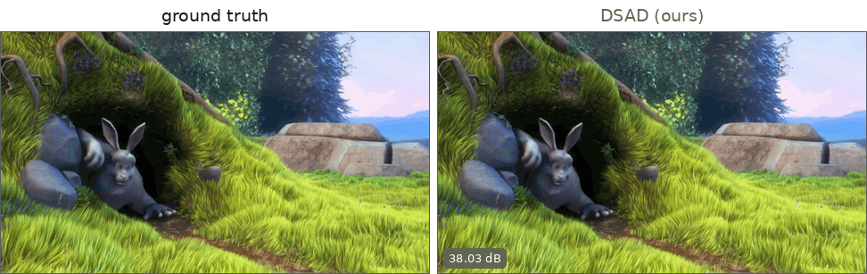
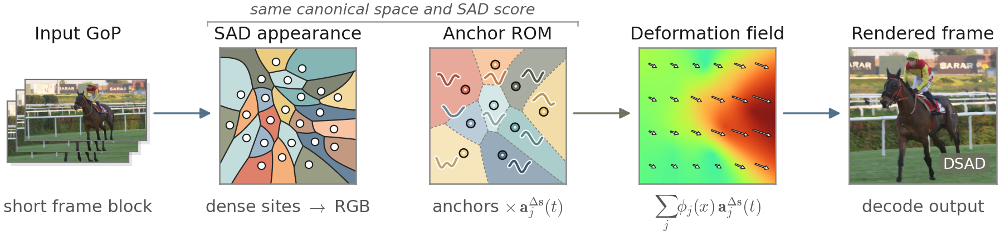
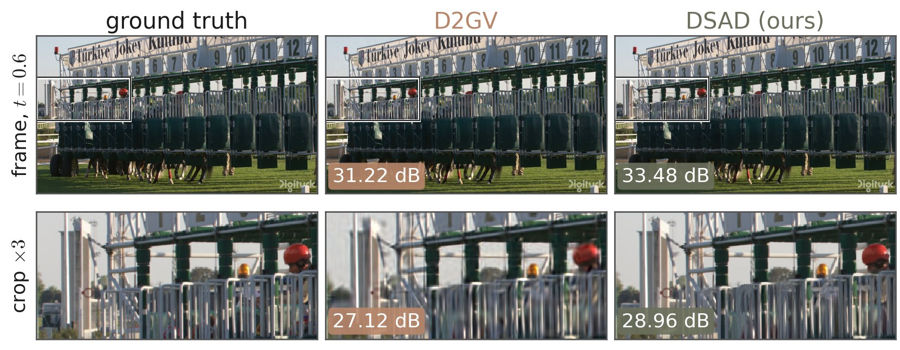

<div align="center">
<h1>DSAD: Dynamic Soft Anisotropic Diagrams for Reduced-Order Video Representation</h1>

<a href="https://frank-zy-dou.github.io/projects/DSAD/"></a>
<a href="https://frank-zy-dou.github.io/projects/DSAD/DSAD.pdf"></a>
<a href="https://github.com/Frank-ZY-Dou/Dynamics-Modeling/releases/tag/dsad-v1.0"></a>
<a href="LICENSE"></a>

**Conference on Neural Information Processing Systems (NeurIPS) 2026**

Zhiyang Dou<sup>1</sup>, Laki Iinbor<sup>2</sup>, Wojciech Matusik<sup>1</sup>

<sup>1</sup>MIT CSAIL&emsp;<sup>2</sup>Independent Researcher

<a href="assets/bunny.mp4"></a>
</div>

<p align="center"><sub>Big Buck Bunny (&copy; Blender Foundation), 13 GoPs decoded from the released models at 3 M parameters per video. Click for the 24 fps video.</sub></p>

DSAD represents a group of pictures (GoP) with explicit primitives and no neural network. One soft-distance rule is used at two scales:

- **Sites.** Dense sites of a [Soft Anisotropic Diagram](https://luckyiyi.github.io/SAD/) (SAD) hold the colors. A pixel is a softmax blend of its top-8 sites.
- **Anchors.** A few hundred coarser anchors use the same score. Their weights form a sparse partition of unity over the sites.
- **Reduced-order motion.** Each anchor carries knot-based temporal curves for displacement and color residual, and a site follows its anchors. The motion model has 20,224 parameters at 256 anchors.

<p align="center"></p>

Fused CUDA kernels fit a 10-frame 720p GoP in about 3 minutes and decode it at 706-1,095 FPS (benchmark means) from a cold start on one RTX 2080 Ti. DSAD extends [SAD](https://luckyiyi.github.io/SAD/) (SIGGRAPH 2026), our image representation, to video.

## Installation

Requires Linux, an NVIDIA GPU, the CUDA toolkit (`nvcc`) and a C++ compiler. Tested with Python 3.10, PyTorch 2.9.1 (CUDA 12.8) and nvcc 12.4 on an RTX 2080 Ti.

```bash
git clone --filter=blob:none --sparse https://github.com/Frank-ZY-Dou/Dynamics-Modeling.git
cd Dynamics-Modeling && git sparse-checkout set DSAD && cd DSAD

conda create -n dsad python=3.10 -y && conda activate dsad
pip install torch==2.9.1 torchvision==0.24.1 --index-url https://download.pytorch.org/whl/cu128
pip install -r requirements.txt
bash setup.sh                 # fetches the SAD and D2GV submodules, builds the CUDA extensions (about 5 minutes)
bash scripts/smoke_test.sh    # a short fit and decode
```

## Data

Big Buck Bunny ships with the D2GV submodule. UVG and DAVIS 2017 are downloaded from their owners (see [`data/README.md`](data/README.md)) and prepared with:

```bash
python scripts/prepare_data.py uvg   --src <folder with the UVG archives>
python scripts/prepare_data.py davis --src DAVIS-2017-trainval-Full-Resolution.zip
python scripts/prepare_data.py verify            # pixel checksums of the 151 GoPs
```

## Usage

```bash
# Fit one GoP: Bunny GoP 1, 27,047 sites, about 1.5 minutes
python dsad/train_sad_video.py --config configs/dsad.yaml -d baselines/D2GV/dataset/bunny/bunny_1 \
    --num_points 27047 --iterations 60000 --sad_step_size 20000 --data_name quick

# Decode it from its stored parameters: PSNR, MS-SSIM and decode rate
python dsad/decode.py --run checkpoints/quick/SAD3_60000_27047/bunny_1 --steady
```

- The decoder reads only `stored.npz`: 9 numbers per site and the motion model. This fit decodes at about 38.7 dB.
- Your own video: put the frames of one GoP in a folder and pass it with `-d`. A GoP stores 9 N + 7 M + 9 M K parameters for N sites (`--num_points`), M anchors and K knots.
- Always pass `configs/dsad.yaml`: the command-line defaults are not the paper's configuration. `configs/dsad_gs.yaml` is the DSAD-GS ablation, with Gaussians in place of SAD sites.

## Benchmarks

```bash
mkdir -p jobs
python scripts/make_jobs.py > jobs/main.txt                        # UVG and DAVIS at both budgets, 302 fits
bash scripts/run_jobs.sh jobs/main.txt 0 1 2 3                     # one worker per GPU, resumable
python scripts/score_decode.py --runs 'checkpoints/dsad_*'         # decode every fit
python scripts/summarize.py                                        # PSNR and MS-SSIM per scene and benchmark
```

The fits take about 15 GPU-hours on idle RTX 2080 Ti GPUs. For Bunny, pass `bunny` or `bunny3m` to `make_jobs.py` and `summarize.py`. [`configs/benchmarks.yaml`](configs/benchmarks.yaml) lists the sites and anchors of every GoP.

## Results

PSNR (dB) / MS-SSIM at 1280x720 among GoP primitives, under the D2GV-AR protocol and budgets:

| Method | UVG-Small | UVG-Large | DAVIS-Small | DAVIS-Large |
|---|---|---|---|---|
| D-3DGS<sup>&dagger;</sup> | 26.27 / 0.8868 | 28.54 / 0.9124 | 24.54 / 0.8385 | 26.48 / 0.8808 |
| D2GV-AR<sup>&dagger;</sup> | 35.03 / **0.9663** | 35.83 / **0.9728** | 29.82 / 0.9457 | 31.87 / 0.9668 |
| D2GV (paired) | 34.80 / 0.9592 | 35.61 / 0.9636 | 29.82 / 0.9361 | 32.48 / 0.9673 |
| **DSAD** | **35.50** / 0.9635 | **36.43** / 0.9704 | **33.97** / **0.9745** | **35.93** / **0.9826** |

<sup>&dagger;</sup> Reported by D2GV-AR. The paired D2GV is fitted on the same GoPs with its original MLP, at the same training length and parameter budget: DSAD gains +1.92 dB on average over the 302 fits and wins 223. On Big Buck Bunny at 3 M parameters DSAD reaches 39.20 dB (D2GV-AR 37.64, paired D2GV 36.42). Baseline numbers are from the paper; this repository reproduces the DSAD rows.

<p align="center"></p>
<p align="center"><sub>UVG ReadySetGo, GoP 1, UVG-Small budget: ground truth, paired D2GV and DSAD, with per-frame PSNR.</sub></p>

Speed at 1280x720 on one RTX 2080 Ti (means over GoP 1 of every scene):

| | UVG-Small | UVG-Large | DAVIS-Small | DAVIS-Large |
|---|---|---|---|---|
| D2GV (paired), decode FPS | 444 | 279 | 501 | 294 |
| **DSAD**, decode FPS, cold start | **909** | **769** | **1,095** | **706** |
| **DSAD**, decode FPS, steady state | **4,946** | **4,196** | **5,187** | **4,361** |
| D2GV (paired), fit s/frame | 161.2 | 177.0 | 187.5 | 161.0 |
| **DSAD**, fit s/frame | **16.1** | **19.3** | **16.7** | **20.9** |

A cold start builds every frame's candidates from the stored parameters. Steady state reuses them.

## Models and Logs

Scores, training logs and models of our fits are attached to the [`dsad-v1.0`](https://github.com/Frank-ZY-Dou/Dynamics-Modeling/releases/tag/dsad-v1.0) release. DAVIS fits come as scores and logs only.

| Archive | Contents | Size | License |
|---|---|---|---|
| `dsad-records-v1` | scores, logs and commands of the 328 fits (UVG, DAVIS, Bunny) | 1.2 MB | MIT |
| `dsad-models-uvg-v1` | models of the 196 UVG fits | 242 MB | CC BY-NC 3.0 |
| `dsad-models-bunny-v1` | models of the 26 Bunny fits | 24 MB | CC BY 3.0 |

```bash
mkdir -p records
for a in dsad-records-v1 dsad-models-uvg-v1 dsad-models-bunny-v1; do
    wget https://github.com/Frank-ZY-Dou/Dynamics-Modeling/releases/download/dsad-v1.0/$a.tar.zst
    tar --zstd -xf $a.tar.zst -C records             # needs zstd
done
python scripts/summarize.py --records records        # the tables above, from our scores
# Decode a released model (needs the prepared frames of its GoP)
python dsad/decode.py --stored records/tab2/dsad_tab2_uvgS_Beauty_1/stored.npz \
    --gop data/uvg_proto/uvg720/Beauty/Beauty_1 --no_write
```

## Limitations and Future Work

- Full-clip INRs reach higher PSNR at the same budget. Our HiNeRV reproduction is 0.6-3.5 dB above DSAD, at 12-20 FPS and without GoP-wise streaming.
- The gain depends on the scene. D2GV is ahead on 3 of 7 UVG scenes, and D2GV-AR has higher MS-SSIM on UVG.
- Budgets count parameters, not coded bits, and the motion model is translation-only.

Future work: entropy coding with rate-distortion optimization, anchor pruning, and richer motion such as per-anchor affine maps and time-varying site metrics.

## Citation

```bibtex
@inproceedings{dou2026dsad,
  title     = {{DSAD}: Dynamic Soft Anisotropic Diagrams for Reduced-Order Video Representation},
  author    = {Dou, Zhiyang and Iinbor, Laki and Matusik, Wojciech},
  booktitle = {Advances in Neural Information Processing Systems (NeurIPS)},
  year      = {2026}
}

@article{iinbor2026soft,
  title   = {Soft Anisotropic Diagrams for Differentiable Image Representation},
  author  = {Iinbor, Laki and Dou, Zhiyang and Matusik, Wojciech},
  journal = {ACM Transactions on Graphics},
  volume  = {45},
  number  = {4},
  pages   = {158:1--158:19},
  year    = {2026},
  doi     = {10.1145/3811372}
}
```

## License

The code is released under the [MIT License](LICENSE); third-party notices are in [`THIRD_PARTY_NOTICES.md`](THIRD_PARTY_NOTICES.md). Datasets are not redistributed. Released models and the figures in `assets/` keep the terms of their videos: CC BY-NC 3.0 for UVG (Digiturk) and CC BY 3.0 for Big Buck Bunny (Blender Foundation).

## Acknowledgements

DSAD builds on [SAD](https://github.com/LuckyIYI/SAD). Its training loop follows [D2GV](https://github.com/Evan-sudo/D2GV) and [GaussianImage](https://github.com/Xinjie-Q/GaussianImage), and it uses the [Adan](https://github.com/sail-sg/Adan) optimizer. We thank the authors for releasing their code.
