<div align="center">
<h1>RigidFormer: Learning Rigid Dynamics using Transformers</h1>

<a href="https://people.csail.mit.edu/frankzydou/projects/RigidFormer/index.html"></a>
<a href="https://frank-zy-dou.github.io/projects/RigidFormer/index.html#interactive-demo"></a>
<a href="https://arxiv.org/abs/2605.09196"></a>
<a href="LICENSE"></a>
<a href="https://huggingface.co/datasets/frankzydou/RigidFormer-MOVi"></a>
<a href="https://huggingface.co/frankzydou/RigidFormer"></a>

**Conference on Neural Information Processing Systems (NeurIPS) 2026**

Zhiyang Dou<sup>1</sup>, Minghao Guo<sup>1</sup>, Haixu Wu<sup>1</sup>, Doug Roble<sup>2</sup>, Tuur Stuyck<sup>2</sup>, Wojciech Matusik<sup>1</sup>

<sup>1</sup>MIT&emsp;<sup>2</sup>Meta
</div>

<table>
<tr>
<td><a href="assets/MoviB_sample_2.mp4">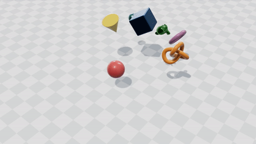</a></td>
<td><a href="assets/MoviA_sample_1.mp4">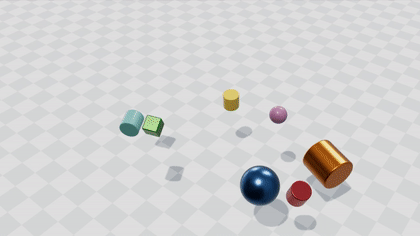</a></td>
</tr>
<tr>
<td><a href="assets/MoviB_sample_1.mp4">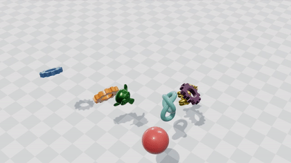</a></td>
<td><a href="assets/MoviS_sample_1.mp4">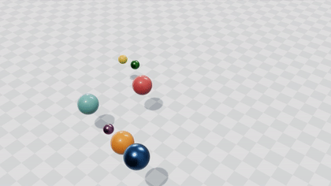</a></td>
</tr>
</table>
<p align="center"><i>RigidFormer rollouts from point inputs on MOVi-Sphere, MOVi-A and MOVi-B.</i></p>

---

## 🔥 News

- **[2026-10]** Code release: training, evaluation and data processing for MOVi-Sphere, MOVi-A and MOVi-B, with [pretrained models](https://huggingface.co/frankzydou/RigidFormer) on Hugging Face.
- **[2026-10]** The [RigidFormer MOVi dataset](https://huggingface.co/datasets/frankzydou/RigidFormer-MOVi) is on Hugging Face: MOVi-Sphere, MOVi-A and MOVi-B with every simulated object, collision meshes, point clouds, camera and image annotations, and the rendered videos.
- **[2026-09]** RigidFormer is accepted to NeurIPS 2026.
- **[2026-05]** The paper is on [arXiv](https://arxiv.org/abs/2605.09196).

## 📖 Overview

Learning-based simulation of multi-object rigid-body dynamics remains difficult because contact is discontinuous and errors compound over long horizons. Most existing methods remain tied to mesh connectivity and vertex-level message passing, which limits their applicability to mesh-free inputs such as point clouds and leads to high computational cost.

**RigidFormer** is an object-centric Transformer that learns mesh-free rigid-body dynamics with controllable integration step sizes.

- **Mesh-free.** Each object is a set of points without mesh connectivity: mesh vertices, points sampled on its surface, or the points a depth camera sees of it.
- **Object-level reasoning.** Each object advances through a few compact anchors; *Anchor-Vertex Pooling* enriches the anchors with local vertex features, keeping contact-relevant geometry without dense vertex-level interaction.
- **Anchor-based RoPE.** Anchor geometry enters attention while respecting the unordered nature of objects and anchors: object-token processing is permutation-equivariant, and the mean-pooled anchor descriptor is invariant to anchor reindexing while preserving shape extent.
- **Rigidity by construction.** Predicted updates are projected onto the rigid-body manifold with differentiable Kabsch alignment.
- **Controllable step size.** One model rolls out with step sizes 1, 5 and 10.

On MOVi-Sphere, MOVi-A and MOVi-B, RigidFormer outperforms or matches mesh-based baselines using point inputs, runs faster, and generalizes to unseen point resolutions and across datasets.

## 🛠️ Environment Setup

Tested with Python 3.10, PyTorch 2.6.0 (CUDA 12.4) and the versions pinned in [`requirements.txt`](requirements.txt), on A100 GPUs.

```bash
conda create -n rigidformer python=3.10 -y
conda activate rigidformer
pip install torch==2.6.0 --index-url https://download.pytorch.org/whl/cu124
pip install flash-attn==2.7.4.post1 --no-build-isolation   # compiles against the installed torch; needs the CUDA toolkit
pip install -r requirements.txt
```

A GPU is required: the CUDA KNN and Flash-Attention have no CPU path. Rollout videos are rendered offscreen with Open3D (EGL) and encoded with `ffmpeg`, which must be on the `PATH`.

## 📊 Dataset

We train and evaluate on **MOVi-Sphere**, **MOVi-A** and **MOVi-B**, multi-object rigid-body scenes simulated with Kubric and PyBullet (1,200 scenes each, split 960 / 120 / 120). The data is on Hugging Face as [`frankzydou/RigidFormer-MOVi`](https://huggingface.co/datasets/frankzydou/RigidFormer-MOVi): the trajectory of every simulated object, the physical properties, the collision meshes, point clouds of every shape, the camera with image annotations, and the rendered videos. Its [dataset card](https://huggingface.co/datasets/frankzydou/RigidFormer-MOVi) describes every field.

Download the scenes and meshes (0.84 GB; the videos are not needed for training) and write the training layout, 27.7 GB in 11.4 million files:

```bash
hf download frankzydou/RigidFormer-MOVi --repo-type dataset --local-dir RigidFormer-MOVi \
    --include "data/movi_*/*" --include "assets/*" --include manifest.json
python data_generation/materialize_hf_dataset.py --dataset RigidFormer-MOVi --out datasets --workers 16
```

The written files are identical to the conversion of the raw Kubric scenes. To build them from the raw scenes instead (download, recovery of the objects that never come into view, conversion, checks), follow [`data_generation/README.md`](data_generation/README.md).

With `--packed`, each scene stores the same per-frame vertices in a single `frames.npy` (every object of every frame) instead of one file per object and frame, i.e. two files per scene instead of ~5,000. This suits network file systems and small local disks; the loader and the evaluation read both layouts ([`src/data/scene_frames.py`](src/data/scene_frames.py)).

<details>
<summary><b>Repository layout</b></summary>

```
RigidFormer/
├── configs/movi_{sphere,a,b}.yaml    # training and evaluation configuration per dataset
├── configs/movi_{sphere,a,b}_partial.yaml   # fine-tuning on partial point clouds (docs/partial_point_clouds.md)
├── demo/                             # interactive viewer of exported rollouts (three.js)
├── docs/                             # partial point clouds: depth camera, completion network, fine-tuning
├── data_generation/                  # raw MOVi scenes -> training data; Hugging Face export and materialization
├── scripts/                          # train.sh, eval.sh, the evaluation driver, rollout export and videos, data checks
├── src/                              # model, data loader, rollout evaluator
├── tests/
├── dataset_split_*_1200.json         # train / validation / test scene lists (960 / 120 / 120)
├── pregen_cf_anchors.py, pregen_fps_order.py   # optional: anchor caches ahead of training
└── requirements.txt
```

</details>

## 🏋️ Training

```bash
bash scripts/train.sh                                        # MOVi-B on all visible GPUs
CONFIG=configs/movi_sphere.yaml GPUS=0,1,2,3 bash scripts/train.sh
CONFIG=configs/movi_a.yaml      GPUS=0,1,2,3 bash scripts/train.sh
```

<details>
<summary><b>Training details</b></summary>

The model predicts accelerations that are integrated with the Verlet formula; training (forward) and rollout (inference) share the same code path. The configs train for 300 epochs with an exponential moving average of the weights: MOVi-B on 6 GPUs x 21 scenes, MOVi-Sphere and MOVi-A on 4 GPUs x 32 scenes. Runs write logs, per-epoch evaluations and checkpoints to `exps/`.

The loader builds missing anchor caches on first use; to build them ahead of training:

```bash
for d in MOVi-Sphere MOVi-A MOVi-B; do
  python pregen_cf_anchors.py . datasets/$d 4 && python pregen_fps_order.py . datasets/$d
done
```

</details>

## 🎯 Evaluation

**1. Get a model.** Download the pretrained models from [`frankzydou/RigidFormer`](https://huggingface.co/frankzydou/RigidFormer), or use a checkpoint of your own training run:

| Weights | Trained on | Config |
|---|---|---|
| `rigidformer_movisphere.pth` | MOVi-Sphere | [`configs/movi_sphere.yaml`](configs/movi_sphere.yaml) |
| `rigidformer_movia.pth` | MOVi-A | [`configs/movi_a.yaml`](configs/movi_a.yaml) |
| `rigidformer_movib.pth` | MOVi-B | [`configs/movi_b.yaml`](configs/movi_b.yaml) |

```bash
hf download frankzydou/RigidFormer rigidformer_movisphere.pth rigidformer_movia.pth rigidformer_movib.pth --local-dir checkpoints
```

**2. Evaluate.**

```bash
bash scripts/eval.sh                  # MOVi-B model on the MOVi-B test scenes
TARGETS=B,A,S bash scripts/eval.sh    # with zero-shot transfer to MOVi-A and MOVi-Sphere
CHECKPOINT=checkpoints/rigidformer_movia.pth      BASE_CONFIG=configs/movi_a.yaml      TARGETS=A bash scripts/eval.sh
CHECKPOINT=checkpoints/rigidformer_movisphere.pth BASE_CONFIG=configs/movi_sphere.yaml TARGETS=S bash scripts/eval.sh
```

After the metrics, the script renders the model's predictions on the first three test scenes at every step size to `videos/<dataset>/scene_<n>_step_<s>.mp4` (rendering does not change the metrics). `RENDER=0` turns this off, `RENDER=N` renders N scenes and `FLOOR=dark` uses a dark floor.

**Fast inference.** Two opt-in switches make the rollout faster, `--cuda-graph` and `--compile` of `src/train.py` (`CUDA_GRAPH=1` and `COMPILE=1` for `scripts/eval.sh`); without them the default path runs. Time per step on the MOVi-B test scene 72 (10 objects, 4,016 vertices; 50-step rollout at step size 1, mean &plusmn; standard deviation over 10 rollouts) on an NVIDIA GeForce RTX 5080:

<table align="center">
<tr><th><sub>Switch</sub></th><th><sub>ms / step</sub></th><th><sub>FPS</sub></th><th><sub>Peak memory</sub></th></tr>
<tr><td><sub>default</sub></td><td><sub>11.96 &plusmn;&nbsp;0.19</sub></td><td><sub>83.6</sub></td><td><sub>835&nbsp;MiB</sub></td></tr>
<tr><td><sub><code>CUDA_GRAPH=1</code></sub></td><td><sub>7.94 &plusmn;&nbsp;0.07</sub></td><td><sub>126.0</sub></td><td><sub>933&nbsp;MiB</sub></td></tr>
<tr><td><sub><code>COMPILE=1</code></sub></td><td><sub>9.07 &plusmn;&nbsp;0.18</sub></td><td><sub>110.3</sub></td><td><sub>779&nbsp;MiB</sub></td></tr>
</table>

```bash
CUDA_GRAPH=1 bash scripts/eval.sh     # or: python src/train.py ... --cuda-graph
COMPILE=1    bash scripts/eval.sh     # or: python src/train.py ... --compile
```

With `--cuda-graph` the rollout step is captured once as a CUDA graph and replayed for the remaining steps; trajectories are bit-identical to the default path. With `--compile` the encoder, decoder and predictor are compiled with `torch.compile` after a one-time compilation (about two minutes on this GPU). Kernel fusion reorders floating-point arithmetic, so rotation cells can move by a few thousandths of a degree and long-horizon cells within the run-to-run band; prefer `--cuda-graph` when exact reproduction matters.

<details>
<summary><b>Evaluation protocol</b></summary>

The script rolls the model out on the 120 test scenes from four ground-truth frames and reports the position RMSE (m) and the rotation error (deg) at physical frames 25, 50, 75, 100, 200, 300 and 400 for step sizes 1, 5 and 10. Every horizon is evaluated on the step-size grid: with step size 10, @25 and @75 fall between two predicted frames and are reported as /. Object positions are recovered from the predicted vertices with HopNet's shape matching, which is exact for a perfect prediction.

Evaluate a checkpoint with the config it was trained with: a checkpoint that stores its configuration (the released weights files do) is refused when a model setting differs. The reported numbers come from single-GPU evaluations (`GPUS=0 CUDA_GRAPH=1`); an evaluation over several GPUs sums in another order, which can change the last digits at long horizons.

</details>


## 🎨 Visualization

Videos come from a fast offscreen renderer ([`src/utils/rollout_render.py`](src/utils/rollout_render.py), physically based, through Open3D): every object is drawn with its render mesh, moved by the rigid motion the model predicts for its collision mesh, on a light or dark checker floor. Videos play in real time at 60 fps (about 0.2 s per 720p frame to render); with step sizes 5 and 10 the poses between predictions are interpolated for display.

**During training.** `training.checkpoint.save_video: true` renders rollouts of a few training and test scenes every `video_every_n_epochs`; `if_overlay: true` adds the ground truth as translucent objects. The same videos for any checkpoint:

```bash
CHECKPOINT=checkpoints/rigidformer_movib.pth BASE_CONFIG=configs/movi_b.yaml OUT=videos/movi_b_overlay OVERLAY=1 bash scripts/render_videos.sh
```

**Interactive viewer.** Try it on the [project page](https://frank-zy-dou.github.io/projects/RigidFormer/index.html#interactive-demo): RigidFormer's predictions on MOVi test scenes in the browser (three.js), with the dataset, the test scene and the step size to choose, play, pause and orbit, on a light or dark floor. [`demo/index.html`](demo/index.html) is the same viewer for rollouts you export yourself:

```bash
python scripts/export_rollouts.py --checkpoint checkpoints/rigidformer_movib.pth --config configs/movi_b.yaml --target B --out rollouts/movi_b
python scripts/build_demo_data.py --rollouts MOVi-B=rollouts/movi_b --scenes 6 --out demo/data
python -m http.server 8000 --directory demo        # then open http://localhost:8000
```

`export_rollouts.py` runs the evaluation and records the predicted pose of every object in every frame; `build_demo_data.py` picks, among the busier half of the test scenes, those with the lowest prediction error.

## 📷 Partial Point Clouds

RigidFormer can also be trained and evaluated on partial point clouds from a single depth camera: each object is represented by the points of its segment in one depth image, and a completion network adds points on its occluded side. [`docs/partial_point_clouds.md`](docs/partial_point_clouds.md) describes the depth camera, the completion network, fine-tuning, evaluation and the data.

The fine-tuned models and the completion network are on [`frankzydou/RigidFormer`](https://huggingface.co/frankzydou/RigidFormer):

| Weights | Trained on | Config |
|---|---|---|
| `rigidformer_movisphere_partial.pth` | MOVi-Sphere, partial point clouds | [`configs/movi_sphere_partial.yaml`](configs/movi_sphere_partial.yaml) |
| `rigidformer_movia_partial.pth` | MOVi-A, partial point clouds | [`configs/movi_a_partial.yaml`](configs/movi_a_partial.yaml) |
| `rigidformer_movib_partial.pth` | MOVi-B, partial point clouds | [`configs/movi_b_partial.yaml`](configs/movi_b_partial.yaml) |
| `completion/completion.pth` | completion network | [`configs/completion_data_movi_b_aug.yaml`](configs/completion_data_movi_b_aug.yaml) |

```bash
hf download frankzydou/RigidFormer rigidformer_movisphere_partial.pth rigidformer_movia_partial.pth rigidformer_movib_partial.pth completion/completion.pth --local-dir checkpoints
CHECKPOINT=checkpoints/rigidformer_movia_partial.pth BASE_CONFIG=configs/movi_a_partial.yaml TARGETS=A bash scripts/eval.sh   # likewise movi_b_partial.yaml, movi_sphere_partial.yaml
CONFIG=configs/movi_a_partial.yaml bash scripts/train.sh --checkpoint=checkpoints/rigidformer_movia.pth   # fine-tuning the released model
```

## 🎬 Gallery

> RigidFormer's predictions from point inputs on held-out test scenes, played in real time; meshes are shown only for visualization. Click a preview to open the MP4. More results are on the [project page](https://people.csail.mit.edu/frankzydou/projects/RigidFormer/index.html), with an [interactive demo](https://frank-zy-dou.github.io/projects/RigidFormer/index.html#interactive-demo).

### MOVi-Sphere

<table>
<tr>
<td><a href="assets/MoviS_sample_1.mp4"></a></td>
<td><a href="assets/MoviS_sample_2.mp4">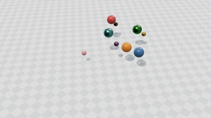</a></td>
<td><a href="assets/MoviS_sample_3.mp4">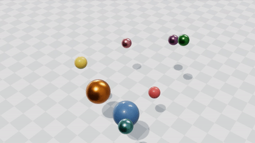</a></td>
</tr>
<tr>
<td><a href="assets/MoviS_sample_4.mp4">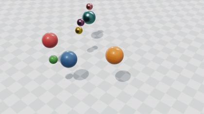</a></td>
<td><a href="assets/MoviS_sample_5.mp4">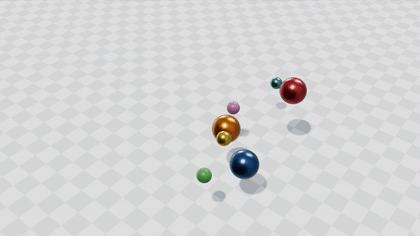</a></td>
<td><a href="assets/MoviS_sample_6.mp4">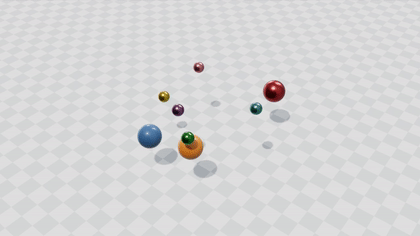</a></td>
</tr>
</table>

### MOVi-A

<table>
<tr>
<td><a href="assets/MoviA_sample_1.mp4"></a></td>
<td><a href="assets/MoviA_sample_2.mp4">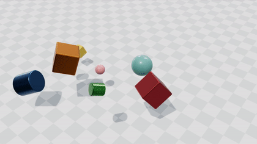</a></td>
<td><a href="assets/MoviA_sample_3.mp4">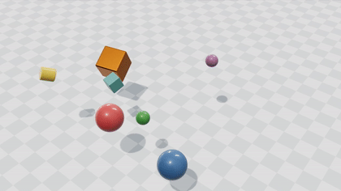</a></td>
</tr>
<tr>
<td><a href="assets/MoviA_sample_4.mp4">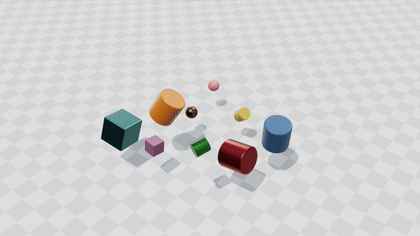</a></td>
<td><a href="assets/MoviA_sample_5.mp4">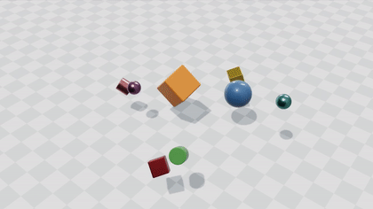</a></td>
<td><a href="assets/MoviA_sample_6.mp4">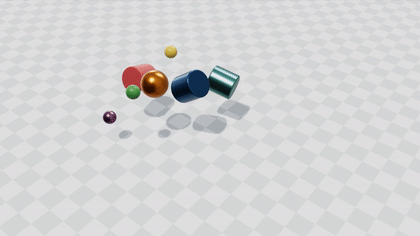</a></td>
</tr>
</table>

### MOVi-B

<table>
<tr>
<td><a href="assets/MoviB_sample_1.mp4"></a></td>
<td><a href="assets/MoviB_sample_2.mp4"></a></td>
<td><a href="assets/MoviB_sample_3.mp4">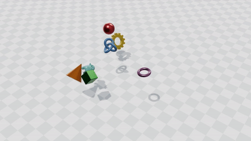</a></td>
</tr>
<tr>
<td><a href="assets/MoviB_sample_4.mp4">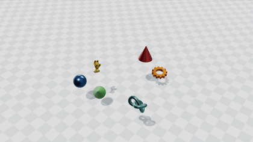</a></td>
<td><a href="assets/MoviB_sample_5.mp4">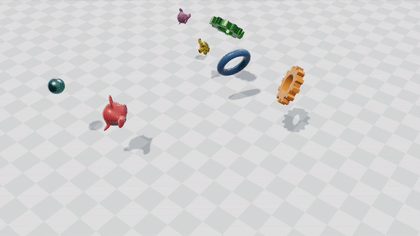</a></td>
<td><a href="assets/MoviB_sample_6.mp4">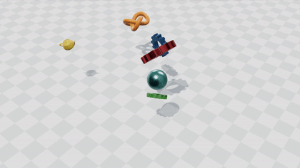</a></td>
</tr>
</table>

### Step sizes

<table>
<tr>
<th>Step size 1</th>
<th>Step size 5</th>
<th>Step size 10</th>
</tr>
<tr>
<td><a href="assets/MoviB_sample_1.mp4"></a></td>
<td><a href="assets/MoviB_step_5.mp4">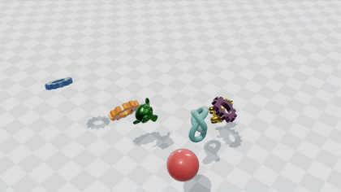</a></td>
<td><a href="assets/MoviB_step_10.mp4">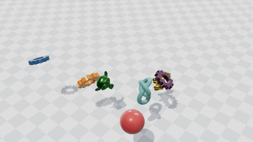</a></td>
</tr>
</table>
<p align="center"><i>One model on one MOVi-B test scene at three step sizes: 240, 48 and 24 predictions per second of simulated time, played in real time (between predictions, poses are interpolated for display).</i></p>

### Partial point clouds

<table>
<tr>
<th>Depth image</th>
<th>Segmentation</th>
<th>Rollout</th>
</tr>
<tr>
<td></td>
<td></td>
<td><a href="assets/MoviA_partial_1.mp4">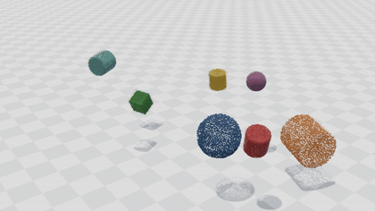</a></td>
</tr>
<tr>
<td></td>
<td></td>
<td><a href="assets/MoviA_partial_2.mp4">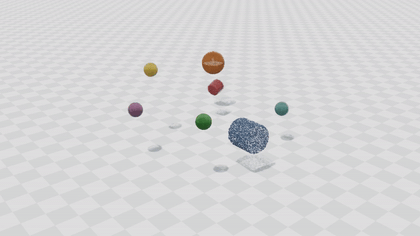</a></td>
</tr>
<tr>
<td></td>
<td></td>
<td><a href="assets/MoviB_partial_1.mp4">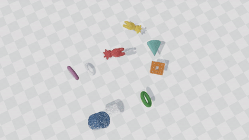</a></td>
</tr>
<tr>
<td>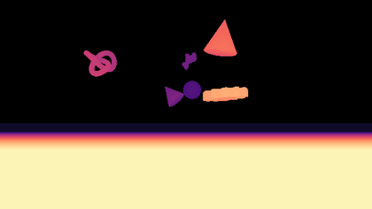</td>
<td></td>
<td><a href="assets/MoviB_partial_2.mp4">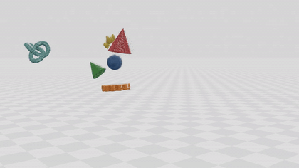</a></td>
</tr>
<tr>
<td></td>
<td></td>
<td><a href="assets/MoviSphere_partial_1.mp4">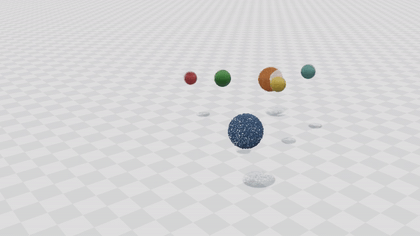</a></td>
</tr>
<tr>
<td></td>
<td></td>
<td><a href="assets/MoviSphere_partial_2.mp4">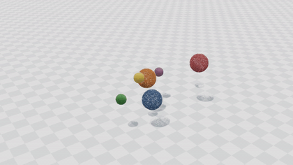</a></td>
</tr>
</table>
<p align="center"><i>Test scenes of MOVi-A, MOVi-B and MOVi-Sphere observed by a single depth camera. Opaque points are observed by the camera and light points are predicted by the completion network.</i></p>

## 📈 Results

Test scenes of each dataset; every cell reports the position RMSE (m, top) and the orientation RMSE (&deg;, bottom) at the given prediction horizon (frames). **Bold**: best, <ins>underlined</ins>: second best.

**Performance on MOVi-A, MOVi-B and MOVi-Sphere** (best and second best per column).

<table align="center">
<tr><th rowspan="2"><sub>Model</sub></th><th colspan="3"><sub>MOVi-A</sub></th><th colspan="3"><sub>MOVi-B</sub></th><th colspan="3"><sub>MOVi-Sphere</sub></th></tr>
<tr><th><sub>50</sub></th><th><sub>75</sub></th><th><sub>100</sub></th><th><sub>50</sub></th><th><sub>75</sub></th><th><sub>100</sub></th><th><sub>50</sub></th><th><sub>75</sub></th><th><sub>100</sub></th></tr>
<tr><td><sub>MGN+</sub></td><td><sub>0.705<br>31.21</sub></td><td><sub>N/A</sub></td><td><sub>N/A</sub></td><td><sub>0.538<br>26.91</sub></td><td><sub>N/A</sub></td><td><sub>N/A</sub></td><td><sub>N/A</sub></td><td><sub>N/A</sub></td><td><sub>N/A</sub></td></tr>
<tr><td><sub>MGN-LargeRadius+</sub></td><td><sub>0.119<br>15.07</sub></td><td><sub>N/A</sub></td><td><sub>N/A</sub></td><td><sub>0.460<br>26.34</sub></td><td><sub>N/A</sub></td><td><sub>N/A</sub></td><td><sub>N/A</sub></td><td><sub>N/A</sub></td><td><sub>N/A</sub></td></tr>
<tr><td><sub>FIGNet</sub></td><td><sub>0.115<br>14.84</sub></td><td><sub>N/A</sub></td><td><sub>N/A</sub></td><td><sub>0.127<br>13.99</sub></td><td><sub>N/A</sub></td><td><sub>N/A</sub></td><td><sub>N/A</sub></td><td><sub>N/A</sub></td><td><sub>N/A</sub></td></tr>
<tr><td><sub>FIGNet<sub>reimpl</sub></sub></td><td><sub>0.132<br>7.10</sub></td><td><sub>0.285<br>14.62</sub></td><td><sub>0.492<br>23.30</sub></td><td><sub>0.141<br>7.39</sub></td><td><sub>0.300<br>15.16</sub></td><td><sub>0.516<br>24.96</sub></td><td><sub>N/A</sub></td><td><sub>N/A</sub></td><td><sub>N/A</sub></td></tr>
<tr><td><sub>HopNet</sub></td><td><sub><ins>0.054</ins><br><ins>5.64</ins></sub></td><td><sub><ins>0.115</ins><br><ins>11.84</ins></sub></td><td><sub><ins>0.196</ins><br><ins>18.83</ins></sub></td><td><sub><ins>0.047</ins><br><ins>4.91</ins></sub></td><td><sub><ins>0.101</ins><br><ins>10.35</ins></sub></td><td><sub><ins>0.176</ins><br><ins>17.91</ins></sub></td><td><sub><ins>0.034</ins><br><ins>4.05</ins></sub></td><td><sub><ins>0.073</ins><br><ins>8.21</ins></sub></td><td><sub><ins>0.124</ins><br><ins>13.68</ins></sub></td></tr>
<tr><td><sub>RigidFormer<sup>&dagger;,*</sup> (Ours)</sub></td><td><sub><b>0.040</b><br><b>4.81</b></sub></td><td><sub><b>0.086</b><br><b>10.64</b></sub></td><td><sub><b>0.145</b><br><b>17.57</b></sub></td><td><sub><b>0.030</b><br><b>3.29</b></sub></td><td><sub><b>0.061</b><br><b>7.16</b></sub></td><td><sub><b>0.108</b><br><b>12.65</b></sub></td><td><sub><b>0.022</b><br><b>2.93</b></sub></td><td><sub><b>0.045</b><br><b>6.28</b></sub></td><td><sub><b>0.078</b><br><b>10.74</b></sub></td></tr>
</table>

<sup>*</sup> Transformer-based model. <sup>&dagger;</sup> Point inputs.

**Generalization across MOVi-Sphere (S), MOVi-A (A) and MOVi-B (B).** Trained on one dataset, tested zero-shot on another, step size 1 (best and second best per row).

<table align="center">
<tr><th rowspan="2"><sub>Train</sub></th><th rowspan="2"><sub>Test</sub></th><th colspan="2"><sub>FIGNet</sub></th><th colspan="2"><sub>HopNet</sub></th><th colspan="2"><sub>RigidFormer (Ours)</sub></th></tr>
<tr><th><sub>75</sub></th><th><sub>100</sub></th><th><sub>75</sub></th><th><sub>100</sub></th><th><sub>75</sub></th><th><sub>100</sub></th></tr>
<tr><td rowspan="2"><sub>S</sub></td><td><sub>A</sub></td><td><sub>0.370<br>14.08</sub></td><td><sub>0.626<br>22.46</sub></td><td><sub><b>0.112</b><br><ins>11.29</ins></sub></td><td><sub><b>0.197</b><br><ins>17.74</ins></sub></td><td><sub><ins>0.122</ins><br><b>10.79</b></sub></td><td><sub><ins>0.205</ins><br><b>17.57</b></sub></td></tr>
<tr><td><sub>B</sub></td><td><sub>0.662<br>18.08</sub></td><td><sub>1.149<br>29.66</sub></td><td><sub><ins>0.106</ins><br><ins>9.75</ins></sub></td><td><sub><ins>0.188</ins><br><ins>17.13</ins></sub></td><td><sub><b>0.081</b><br><b>8.56</b></sub></td><td><sub><b>0.138</b><br><b>15.02</b></sub></td></tr>
<tr><td rowspan="2"><sub>A</sub></td><td><sub>S</sub></td><td><sub>0.239<br>11.55</sub></td><td><sub>0.417<br>19.66</sub></td><td><sub><ins>0.100</ins><br><ins>9.16</ins></sub></td><td><sub><ins>0.172</ins><br><ins>15.17</ins></sub></td><td><sub><b>0.059</b><br><b>7.17</b></sub></td><td><sub><b>0.100</b><br><b>12.59</b></sub></td></tr>
<tr><td><sub>B</sub></td><td><sub>0.512<br>13.49</sub></td><td><sub>0.864<br>22.41</sub></td><td><sub><ins>0.117</ins><br><ins>10.77</ins></sub></td><td><sub><ins>0.202</ins><br><ins>18.66</ins></sub></td><td><sub><b>0.074</b><br><b>8.07</b></sub></td><td><sub><b>0.132</b><br><b>14.46</b></sub></td></tr>
<tr><td rowspan="2"><sub>B</sub></td><td><sub>S</sub></td><td><sub>0.536<br>12.74</sub></td><td><sub>0.905<br>20.42</sub></td><td><sub><ins>0.095</ins><br><ins>9.09</ins></sub></td><td><sub><ins>0.160</ins><br><ins>15.04</ins></sub></td><td><sub><b>0.063</b><br><b>7.78</b></sub></td><td><sub><b>0.110</b><br><b>13.43</b></sub></td></tr>
<tr><td><sub>A</sub></td><td><sub>0.520<br>14.53</sub></td><td><sub>0.871<br>22.89</sub></td><td><sub><ins>0.120</ins><br><ins>12.08</ins></sub></td><td><sub><ins>0.202</ins><br><ins>19.15</ins></sub></td><td><sub><b>0.099</b><br><b>10.62</b></sub></td><td><sub><b>0.165</b><br><b>17.18</b></sub></td></tr>
</table>

**Step-size-conditioned rollouts.** One model per dataset, conditioned on the step size at inference time; "/": the horizon is not on the step-size grid.

<table align="center">
<tr><th rowspan="2"><sub>Step size</sub></th><th colspan="3"><sub>MOVi-A</sub></th><th colspan="3"><sub>MOVi-B</sub></th><th colspan="3"><sub>MOVi-Sphere</sub></th></tr>
<tr><th><sub>50</sub></th><th><sub>75</sub></th><th><sub>100</sub></th><th><sub>50</sub></th><th><sub>75</sub></th><th><sub>100</sub></th><th><sub>50</sub></th><th><sub>75</sub></th><th><sub>100</sub></th></tr>
<tr><td><sub>10</sub></td><td><sub>0.016<br>1.43</sub></td><td><sub>/</sub></td><td><sub>0.092<br>11.26</sub></td><td><sub>0.012<br>1.22</sub></td><td><sub>/</sub></td><td><sub>0.071<br>8.74</sub></td><td><sub>0.010<br>0.88</sub></td><td><sub>/</sub></td><td><sub>0.062<br>6.58</sub></td></tr>
<tr><td><sub>5</sub></td><td><sub>0.029<br>2.94</sub></td><td><sub>0.068<br>7.76</sub></td><td><sub>0.120<br>13.76</sub></td><td><sub>0.020<br>2.71</sub></td><td><sub>0.048<br>6.32</sub></td><td><sub>0.090<br>11.52</sub></td><td><sub>0.017<br>2.02</sub></td><td><sub>0.040<br>4.83</sub></td><td><sub>0.073<br>8.85</sub></td></tr>
<tr><td><sub>1</sub></td><td><sub>0.040<br>4.81</sub></td><td><sub>0.086<br>10.64</sub></td><td><sub>0.145<br>17.57</sub></td><td><sub>0.030<br>3.29</sub></td><td><sub>0.061<br>7.16</sub></td><td><sub>0.108<br>12.65</sub></td><td><sub>0.022<br>2.93</sub></td><td><sub>0.045<br>6.28</sub></td><td><sub>0.078<br>10.74</sub></td></tr>
</table>

**Runtime on MOVi-B.** A 50-step autoregressive rollout averaged over 10 iterations on an NVIDIA GeForce RTX 5080; RigidFormer is 28&times; faster than FIGNet and 354&times; faster than HopNet.

<table align="center">
<tr><th><sub>Model</sub></th><th><sub>ms / step</sub></th><th><sub>FPS</sub></th></tr>
<tr><td><sub>HopNet</sub></td><td><sub>4228.7</sub></td><td><sub>0.2</sub></td></tr>
<tr><td><sub>FIGNet</sub></td><td><sub>336.0</sub></td><td><sub>3.0</sub></td></tr>
<tr><td><sub>RigidFormer (Ours)</sub></td><td><sub><b>12.0</b></sub></td><td><sub><b>83.6</b></sub></td></tr>
</table>

**Partial point clouds.** Inputs from a single depth camera ([Partial Point Clouds](#-partial-point-clouds)), step size 1. The completion network lowers the position error of the released models on all three datasets; fine-tuning further lowers the orientation error on all three and the position error on MOVi-A and MOVi-B.

<table align="center">
<tr><th rowspan="2"><sub>Input and model</sub></th><th colspan="3"><sub>MOVi-A</sub></th><th colspan="3"><sub>MOVi-B</sub></th><th colspan="3"><sub>MOVi-Sphere</sub></th></tr>
<tr><th><sub>50</sub></th><th><sub>75</sub></th><th><sub>100</sub></th><th><sub>50</sub></th><th><sub>75</sub></th><th><sub>100</sub></th><th><sub>50</sub></th><th><sub>75</sub></th><th><sub>100</sub></th></tr>
<tr><td><sub>Full point clouds, released model</sub></td><td><sub>0.040<br>4.81</sub></td><td><sub>0.086<br>10.64</sub></td><td><sub>0.145<br>17.57</sub></td><td><sub>0.030<br>3.29</sub></td><td><sub>0.061<br>7.16</sub></td><td><sub>0.108<br>12.65</sub></td><td><sub>0.022<br>2.93</sub></td><td><sub>0.045<br>6.28</sub></td><td><sub>0.078<br>10.74</sub></td></tr>
<tr><td><sub>Partial point clouds, released model</sub></td><td><sub>0.055<br>4.84</sub></td><td><sub>0.111<br>10.69</sub></td><td><sub>0.182<br>17.84</sub></td><td><sub>0.041<br>3.75</sub></td><td><sub>0.083<br>8.04</sub></td><td><sub>0.142<br>14.29</sub></td><td><sub>0.053<br>3.30</sub></td><td><sub>0.110<br>7.15</sub></td><td><sub>0.184<br>12.65</sub></td></tr>
<tr><td><sub>Partial point clouds + completion, released model</sub></td><td><sub>0.052<br>5.24</sub></td><td><sub>0.097<br>10.73</sub></td><td><sub>0.162<br>18.02</sub></td><td><sub>0.036<br>3.75</sub></td><td><sub>0.075<br>7.88</sub></td><td><sub>0.129<br>13.48</sub></td><td><sub>0.023<br>3.08</sub></td><td><sub>0.048<br>6.54</sub></td><td><sub>0.083<br>11.10</sub></td></tr>
<tr><td><sub>Partial point clouds + completion, fine-tuned</sub></td><td><sub>0.047<br>4.71</sub></td><td><sub>0.092<br>9.78</sub></td><td><sub>0.156<br>16.44</sub></td><td><sub>0.034<br>3.54</sub></td><td><sub>0.069<br>7.54</sub></td><td><sub>0.120<br>13.21</sub></td><td><sub>0.026<br>2.92</sub></td><td><sub>0.054<br>6.23</sub></td><td><sub>0.093<br>10.63</sub></td></tr>
</table>

## 📝 Citation

If you find RigidFormer useful in your research, please consider citing our work:

```bibtex
@inproceedings{dou2026rigidformer,
  title     = {RigidFormer: Learning Rigid Dynamics using Transformers},
  author    = {Dou, Zhiyang and Guo, Minghao and Wu, Haixu and Roble, Doug and Stuyck, Tuur and Matusik, Wojciech},
  booktitle = {Advances in Neural Information Processing Systems (NeurIPS)},
  year      = {2026}
}
```

## ⚖️ License

The code in this repository is released under the [MIT License](LICENSE). The dataset is released under CC BY 4.0 and is derived from HopNet's MOVi datasets (CC BY 4.0); the KuBasic meshes in `data_generation/objects` are Kubric assets, licensed CC BY-SA 4.0. See the [dataset card](https://huggingface.co/datasets/frankzydou/RigidFormer-MOVi) for details.

## 🤝 Acknowledgement

The MOVi-Sphere, MOVi-A and MOVi-B scenes, their renders and the generator come from [HopNet](https://github.com/AmauryWEI/hopnet) by Amaury Wei and Olga Fink; the scenes were simulated with [Kubric](https://github.com/google-research/kubric), whose KuBasic assets provide the object meshes. We thank the authors for making them available.
