<div align="center">
<h1>SimReady Gate</h1>

**Language-driven, verifier-in-the-loop repair that turns generated tabletop scenes into penetration-free, simulation-ready ones**

*Part of [Dynamics-Modeling](https://github.com/Frank-ZY-Dou/Dynamics-Modeling), research code and projects by [Frank Zhiyang Dou](https://frank-zy-dou.github.io/) from [MIT CDFG](https://cdfg.mit.edu/people/#current).*

*Built on [S4R](../Penetration_Solving/) — Scaling for Rigid-Body Interpenetration Resolution, ACM Transactions on Graphics (SIGGRAPH Asia 2026).*

<a href="LICENSE"></a>
<a href="docs/DIAGNOSTIC_2026-09-08.md"></a>
<a href="../Penetration_Solving/"></a>

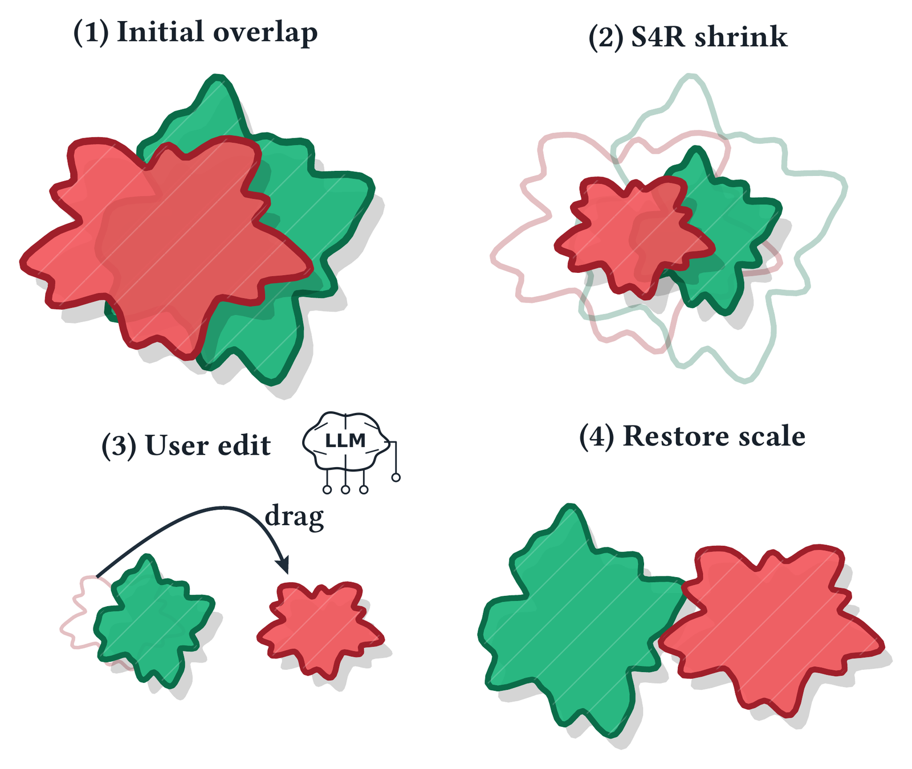

<sub><b>Scale-space editing.</b> (1) Two bodies overlap. (2) S4R shrinks every body about its reference center to the configured scale. (3) The language model moves the shrunken bodies into the requested arrangement. (4) The scale is restored under the program, and the layout comes out penetration-free.</sub>

<table align="center">
<tr>
<td align="center">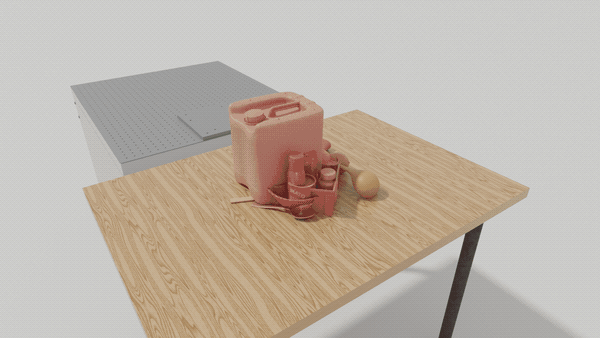</td>
</tr>
<tr>
<td><sub><b>Twenty objects from a heap, laid out by language.</b> Twenty RoboLab catalog objects are dropped into a 13 cm radius on RoboLab's own table (82 object-object interpenetrating pairs). The request asks for a cooking layout: the bowl in front of the pitcher, the ladle and the spoon within reach, the fruit grouped on the left, the cans and bottles in a row at the back, the hammer, bin, remote and spatula out of the way on the right. S4R shrinks every body about its reference center; the model places the shrunken bodies; the scale is restored under the program, and the result is penetration-free with every predicate satisfied, in 5 s.</sub></td>
</tr>
<tr>
<td align="center">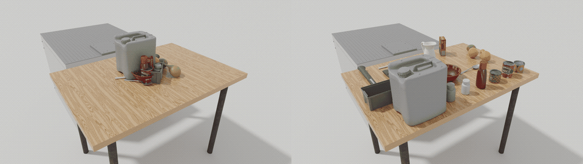</td>
</tr>
<tr>
<td><sub><b>Settle as certification.</b> The heap and the repaired layout simulated in MuJoCo with CoACD proxies: the heap reaches 3.8 m/s and throws a body off the table; the repaired scene peaks at 0.33 m/s with nothing leaving the table. Every clip in this repository is rendered from the solver's own meshes with the assets' textures, without overlays.</sub></td>
</tr>
</table>
</div>

## 📢 Updates

* [October 2026] **Robot scenes and a written semantics.** Layouts name NVIDIA SimReady assets and 37 objects of [scenario-labs/3d-collection](https://huggingface.co/datasets/scenario-labs/3d-collection) (CC BY 4.0, credit: Scenario) ([assets](#assets)). The language gains statements for robot scenes, shelves ([Example 3](#example-3-shelves)) and rings ([demo](#a-robocasa-counter)), and a semantics: the repair's settings form a separate `schedule`, and a failed requirement comes with the nearest relaxation under which it holds ([the language](docs/DSL.md#what-a-program-means)). Programs pass 141 / 144 against 128 / 144 for typed poses, and all 144 with the rewrites in the report ([results](#a-program-or-the-poses)).
* [September 2026] **Into the engines.** `export` writes a repaired scene as meshes, a manifest, an MJCF file and a USD stage with physics schemas; `examples/run_mujoco.py`, `run_genesis.py` and `run_isaac.py` load it and simulate it. The twenty-object layout runs in MuJoCo, Genesis and Isaac Sim with no body leaving the table ([details](#running-the-repaired-scene-in-a-simulator)).
* [September 2026] **Twenty-object demo.** A heap of twenty RoboLab objects laid out by a language request in scale-space, two recorded rounds of the agent loop, one passing certificate; the request, the programs, every tool output and both certificates are in [`docs/examples/pile_n20/`](docs/examples/pile_n20/) ([Example 2](#example-2-twenty-objects-from-a-heap-laid-out-by-language)).
* [September 2026] **Scale-space placement.** `place(a, x, y, yaw)` lets the model position bodies at the configured shrink scale, where overlaps may remain; the continuation restores full scale under the program. Renders from the solver's own meshes with the assets' textures (`viz/`).
* [September 2026] **Initial release**: the scene layer for RoboLab USD scenes (`usd-core`, no Isaac Sim) and RoboCasa MJCF objects (compiled by MuJoCo itself); the constraint language, its JSON schema and compiler; the S4R upright-on-plane repair driven by the program; the mesh-level evaluator with containment and resting-contact tests; the MuJoCo settle test; certificates with provenance; the agent skill and the Anthropic SDK backend; the diagnostics on RoboLab's 68 shipped scenes, on layouts from RoboLab's own placement solver, and on RoboCasa counter regions with RoboCasa's own placement test ([`docs/DIAGNOSTIC_2026-09-08.md`](docs/DIAGNOSTIC_2026-09-08.md)).

## Table of Contents

* [📢 Updates](#-updates)
* [Overview](#overview)
* [Demos](#demos)
   * [Shelves](#shelves) · [A scene RoboLab ships](#a-scene-robolab-ships) · [A layout RoboLab's solver rejects](#a-layout-robolabs-solver-rejects) · [A RoboCasa counter](#a-robocasa-counter)
* [Example 1: a scene RoboLab ships, one request, one certificate](#example-1-a-scene-robolab-ships-one-request-one-certificate)
   * [Summarize](#1-summarize-the-scene) · [Text to program](#2-text-to-program) · [Check](#3-check) · [Repair and write back](#4-repair-and-write-back) · [Settle](#5-settle-as-certification) · [Certificate](#6-the-certificate)
* [Example 2: twenty objects from a heap, laid out by language](#example-2-twenty-objects-from-a-heap-laid-out-by-language)
* [Example 3: shelves](#example-3-shelves)
* [The agent loop](#the-agent-loop)
   * [Scale-space editing](#scale-space-editing)
* [The language](#the-language)
   * [What robot scenes ask for](#what-robot-scenes-ask-for)
* [A program or the poses](#a-program-or-the-poses)
* [Getting started](#getting-started)
   * [Setup](#setup) · [Command line](#command-line) · [Running the repaired scene in a simulator](#running-the-repaired-scene-in-a-simulator) · [Assets](#assets)
* [Gates](#gates)
* [Results](#results)
* [Repository layout](#repository-layout)
* [Citation](#citation)
* [License](#license)

## Overview

Generated scenes reach a simulator with mesh-level interpenetration and with bodies that nothing
supports. SimReady Gate is the layer between a scene generator and the simulator:

- **Reads the scenes robotics pipelines actually produce.** RoboLab USD scenes (payloads, instance proxies, gprims, MDL materials) through `usd-core`, no Isaac Sim needed; RoboCasa / robosuite MJCF objects compiled by MuJoCo itself, so the geometry is exactly what the simulator collides with.
- **Measures interpenetration on the meshes, not on proxies.** An FCL evaluator with probed contact normals, a containment test and a resting-contact test: which pairs interpenetrate, which body sits inside another, which body nothing supports.
- **Repairs with S4R under a typed constraint program.** Bodies shrink about their reference center, grow back through minimum-norm QPs, stay upright on their support, and obey the program: regions, left/right/front/back relations, distances, soft target poses, and the statements robot scenes ask for: reach, gripper clearance, a free approach corridor, handles facing the robot, rows, grids, mirror images, footprint gaps, keep-out zones, small edits, towers, preferences ([the language](#the-language)).
- **Reads NVIDIA SimReady packages.** Search through SimReady Central, fetch from the Hugging Face datasets checked against each package's bill of materials, and carry each asset's mass, friction and semantic class into the repair, the settle test and the export ([assets](#assets)).
- **Lets a language model lay the scene out in scale-space.** At the configured shrink scale overlaps may remain; the model places bodies into a semantic arrangement (`place`), and the continuation restores full scale while resolving what overlaps.
- **Certifies by settling.** The repaired scene is simulated in MuJoCo with the proxies an engine would use (convex hulls, CoACD pieces); peak speed, displacement and bodies that leave their support are measured against the program's own thresholds.
- **Leaves a certificate with provenance.** Program text and JSON, scene hash, git commit, library versions, the tolerances, every predicate value, the settle report.
- **Runs as an agent loop.** An agent following the skill in `skills/` (or the Anthropic SDK backend) writes and edits the program and acts on exit codes; it never overrides a number.

## Demos

### Shelves

<table align="center">
<tr>
<td align="center" width="33%">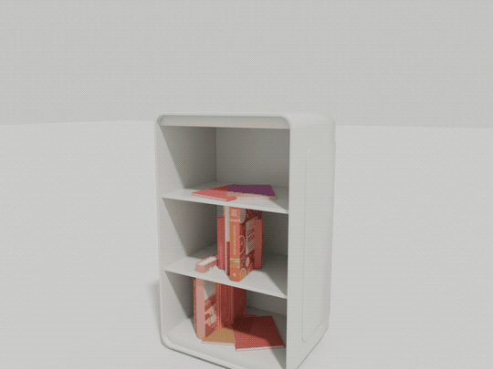</td>
<td align="center" width="33%">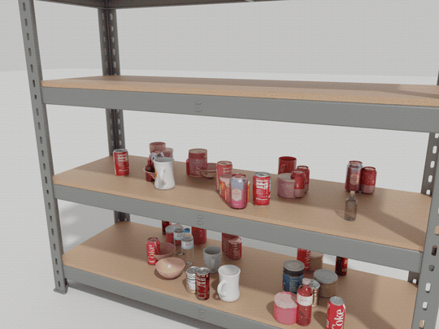</td>
<td align="center" width="33%">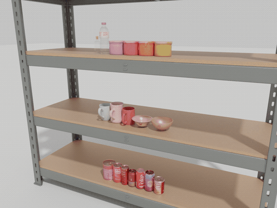</td>
</tr>
<tr>
<td align="center"><sub><code>shelf_books</code></sub></td>
<td align="center"><sub><code>shelf_pantry</code></sub></td>
<td align="center"><sub><code>shelf_fix</code></sub></td>
</tr>
<tr>
<td colspan="3"><sub>SimReady and PalatialSim assets on a bookcase and a rack, interpenetrating bodies tinted, then S4R's scale continuation under the agent's program: books by height with their spines in line; heavy things low and cans in a grid; rows 3 mm too tight, spaced out. Walked through in <a href="#example-3-shelves">Example 3</a>.</sub></td>
</tr>
</table>

### A scene RoboLab ships

<table align="center">
<tr>
<td align="center">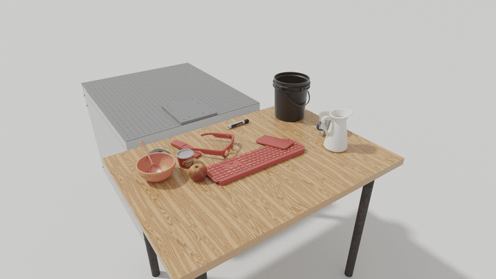</td>
<td align="center">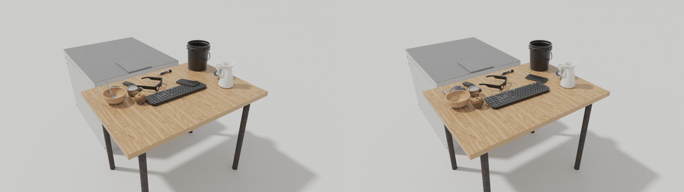</td>
</tr>
<tr>
<td colspan="2"><sub><code>workdesk_snacks</code>, already physics-settled by RoboLab's pipeline, still has three object-object interpenetrations, the largest scoring 9.9 mm (keyboard against smartphone). One sentence of intent and one certificate later it is clean, with 3.3 cm of planar motion. Right: the same scene settled in MuJoCo, as shipped and after the repair. Walked through step by step in <a href="#example-1-a-scene-robolab-ships-one-request-one-certificate">Example 1</a>.</sub></td>
</tr>
</table>

### A layout RoboLab's solver rejects

<table align="center">
<tr>
<td align="center">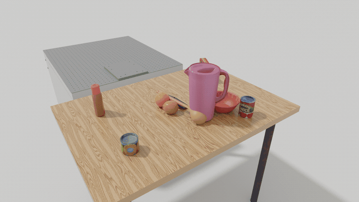</td>
<td align="center">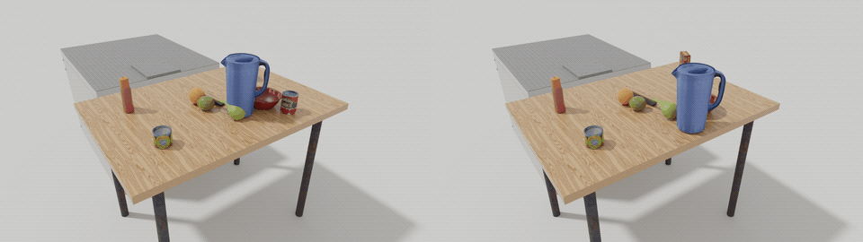</td>
</tr>
<tr>
<td colspan="2"><sub>Ten catalog objects placed by RoboLab's own disc solver in its base scene; the solver reports failure and the layout carries four interpenetrating pairs once seated. The gate repairs it to zero with the requested left/right/front/back relations kept. Right: settled in MuJoCo, the generated layout tips the tomato can onto its side and moves a body 23 cm; the repaired one moves less than 1 cm.</sub></td>
</tr>
</table>

### A RoboCasa counter

<table align="center">
<tr>
<td align="center">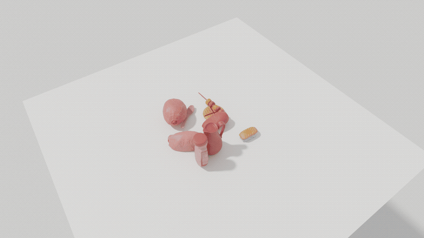</td>
</tr>
<tr>
<td><sub>Ten AI-generated RoboCasa objects in a heap at the centre of a counter, with nine interpenetrating pairs. One statement, <code>ring(*, r=0.2, x=0, y=0)</code>, lays them out evenly on a 20 cm circle; S4R reaches zero penetration in 0.3 s on the objects' V-HACD collision pieces, under <code>on_support</code> and <code>upright</code>.</sub></td>
</tr>
</table>

## Example 1: a scene RoboLab ships, one request, one certificate

`workdesk_snacks.usda` is one of RoboLab's library scenes. It has been through RoboLab's physics
settle and still carries three object-object interpenetrations, the largest scoring 9.9 mm (keyboard and
smartphone). Below it goes through the gate with one sentence of intent.

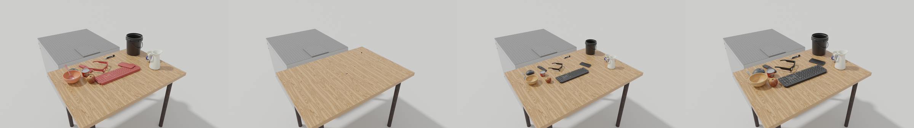

*Left to right: the scene as shipped with the interpenetrating bodies tinted; S4R shrinking every
free body about its reference center and growing it back while the QP moves bodies in the plane;
the repaired scene.*

### 1. Summarize the scene

The agent reads this; it never looks at geometry itself.

```
$ python -m simready.cli summarize "$ROBOLAB_DIR/assets/scenes/workdesk_snacks.usda"
- table: FIXED fixture,support; size 0.70x1.00x0.70 m; at (0.55, -0.00, -0.35); top rect x[0.20, 0.90] y[-0.50, 0.50] at z=0.003
- franka_table: FIXED fixture,support; size 0.90x0.76x0.79 m; at (-0.36, 0.00, -0.40); ...
- ceramic_mug: object; size 0.10x0.13x0.08 m; at (0.56, 0.40, 0.04)
- glasses: object; size 0.20x0.20x0.05 m; at (0.39, -0.10, 0.02)
- keyboard: object; size 0.14x0.43x0.02 m; at (0.57, 0.00, 0.01)
...
```

### 2. Text to program

The request was *"Keep everything on the table, the keyboard in front of the smartphone with at
least 5 cm between them, and nothing interpenetrating."* The model answers the prompt printed by
`python -m simready.cli prompt` with one JSON object (schema-constrained; each statement can carry the words that
justify it):

```json
{"statements": [
  {"op": "no_penetration", "reason": "no interpenetration"},
  {"op": "fixed", "a": "table"}, {"op": "fixed", "a": "franka_table"}, {"op": "fixed", "a": "GroundPlane"},
  {"op": "on_support", "a": "*", "b": "table", "reason": "everything stays on the table"},
  {"op": "upright", "a": "*"},
  {"op": "within", "a": "*", "b": "table.top", "inset": 0.0},
  {"op": "farther", "a": "keyboard", "b": "smartphone", "gap": 0.05, "reason": "keyboard in front of the phone, 5 cm"},
  {"op": "minimize"}],
 "gate": {"settle_v_max": 1.0, "settle_dx": 0.15},
 "assumptions": ["'in front of' read in RoboLab's frame: +x, away from the robot"]}
```

### 3. Check

`check` compiles the program exactly as the repair will; unknown bodies, self-relations and a
region with no room stop here with exit code 2.

```
$ python -m simready.cli check "$ROBOLAB_DIR/assets/scenes/workdesk_snacks.usda" program.json
{"ok": true, "statements": 9, "rows": 27, "predicates": 40, ...}
```

### 4. Repair and write back

S4R runs on decimated proxies, verifies on the full meshes, checks every predicate, writes the
poses into a copy of the USD and reads it back:

```
$ python -m simready.cli repair "$ROBOLAB_DIR/assets/scenes/workdesk_snacks.usda" program.json --out workdesk_repaired.usda
{"ok": true, "pen_before": 12, "pen_after": 0, "rmsd_xy": 0.037, "time_s": 3.4,
 "failed_predicates": [], "written_pose_error_m": 2.1e-05,
 "certificate": "workdesk_repaired.certificate.json"}
```

`pen_before` counts every negative pair, including the sub-millimeter resting contacts with the
table that PhysX leaves behind; three of the twelve are object-object.

### 5. Settle as certification

The repaired scene is simulated twice in MuJoCo, with the proxies a physics engine would use
(convex hulls, CoACD pieces); the thresholds come from the program's `gate` section:

```
$ python -m simready.cli settle workdesk_repaired.usda --program program.json
{"pass": true, "thresholds": {"v_max": 1.0, "d_max": 0.15, "source": "program gate"},
 "hull":  {"peak_speed": 0.577, "peak_disp": 0.0604, "left_support": [], "pass": true},
 "coacd": {"peak_speed": 0.561, "peak_disp": 0.0594, "left_support": [], "pass": true}}
```

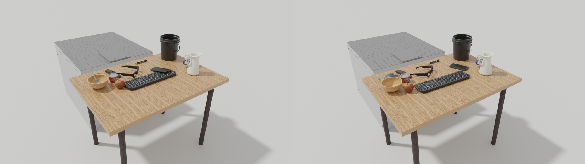

### 6. The certificate

`workdesk_repaired.certificate.json` records the outcome with its provenance: the program text and
JSON, the hashes of the scene read and the scene written and of every asset file the bodies came
from, the git commit, library versions, the schedule, the tolerances, the predicate values, the
settle report.
`settle` adds its report to the certificate only when the scene it was given hashes to the one the
repair wrote, the program to the one the repair used and every asset to what the repair read, and
then sets `ready`: the repair's `ok` and the settle's `pass`. Any other certificate is left as it
is and the settle report goes to a separate `.settle.json`. The settle report also carries the
program's predicates evaluated on the settled poses (`after_settle`, at settle tolerances: 1 cm,
15° of tilt, 10 cm for a placement) and the final tilt of every body; with `--hold-predicates`
those predicates must hold for the settle to pass, and the certificate records which policy was
used.

## Example 2: twenty objects from a heap, laid out by language

Twenty catalog objects are dropped into a 13 cm radius on RoboLab's `table_oak` (seed 2 of
`viz/make_robolab_scene_video.py --pile`): 82 object-object interpenetrating pairs. The request:

> *Twenty things were dumped in a heap on the kitchen table. Lay them out for cooking: the bowl in
> front of the pitcher, the ladle and the big spoon within reach of the bowl, the fruit (both
> oranges, the lime, the lemon) grouped together on the left, the cans and bottles in a row at the
> back, the hammer, the bin, the remote and the spatula out of the way on the right. Everything
> upright on the table, at least 2 cm from the edge, nothing interpenetrating, and do not move
> anything further than necessary.*

The model's first program has 46 statements (the certified second one has 44): the usual guards, one `place` target per object chosen
from the table rectangle and the object sizes (the placement step in scale-space), and the
relations that make the request checkable:

```json
{"op": "place", "a": "bowl", "x": 0.62, "y": 0.00, "reason": "bowl in front (+x) of the pitcher"},
{"op": "place", "a": "orange_02", "x": 0.48, "y": 0.34, "reason": "fruit group on the left (+y)"},
{"op": "place", "a": "pineapple_slices_can", "x": 0.80, "y": 0.42, "reason": "cans and bottles in a row at the back (+x)"},
{"op": "farther", "a": "bowl", "b": "pitcher", "gap": 0.12},
{"op": "close_to", "a": "ladle", "b": "bowl", "r": 0.22},
{"op": "left_of", "a": "orange_02", "b": "bowl", "gap": 0.18},
{"op": "right_of", "a": "hammer_8", "b": "bowl", "gap": 0.22},
...
"gate": {"settle_v_max": 1.0, "settle_dx": 0.15}
```

Two rounds of the loop, both from the tools' own outputs (`viz/run_agent_rounds.sh`); round 2's
program is Claude Opus 5.5's answer to round 1's report (`viz/agent_revise.py`). The request, the
programs, the call, every tool output and both certificates are in
[`docs/examples/pile_n20/`](docs/examples/pile_n20/):

| round | repair | outcome | settle (hull / CoACD) |
|---|---|---|---|
| 1 | 82 → 0 pairs, planar RMSD 0.335 m, 9 s | `place(hammer_8)` missed by 5.3 cm: the 33 cm hammer does not fit at the requested corner next to the bin, the hammer and the bin end at the table's edge, the ladle 2.6 cm beyond its 22 cm | 0.38 / 0.33 m/s, pass |
| 2 | 82 → 0 pairs, planar RMSD 0.325 m, 4 s | the hammer and the bin turned to fit inside the inset, the smaller margin, the ladle's and the spoon's reach a 25 cm preference; every predicate holds, `ready: true` | 0.38 / 0.33 m/s, pass |

Round 1's report lists the rewrites of its failed statements: drop the hammer's target, relax the
ladle's radius to 24.7 cm, or make the 2 cm edge inset a preference, which the request rules out. A
smaller margin alone still misses the hammer's target.

The heap itself, settled as is, reaches 5.2 m/s with eleven bodies off the table (hull proxies)
and 3.8 m/s with one (CoACD). The program's schedule starts the continuation at s = 0.3, large
enough to see the bodies while they are placed; the certificate records it.

The settle report also re-evaluates the program on the settled poses (`after_settle`). It shows
what the peak-speed and displacement thresholds do not: the round fruit rolls out of `upright`
(the lime and one orange, under either proxy) while every other statement
holds, the remote control among them (it lies flat, as it rests in RoboLab's own scenes, and ends
the settle within 1° of where it started). The default policy leaves `ready` to the G5
thresholds and reports this; `--hold-predicates` would make the certificate not ready until the
request is changed for those bodies.

## Example 3: shelves

A fixture's levels come from its mesh. The scene summary lists each one, with the room above it:

```
case.level2 z=0.315 x[0.48, 0.83] y[-0.25, 0.25] headroom 0.261 m
```

What a program can say about them:

- `on_support(book_*, case.level2)`: rest on that level.
- `within`, `keep_out`: stay in, or out of, part of a level.
- `flush(book_1, case.level2, side=near, gap=0.01)`: an edge 1 cm behind the level's front.
- `row(..., edge=min)`: a row whose near edges line up (spines in line).
- `yaw(book_*, deg=180, axis=front)`: the side a body's data names faces out.

`check` refuses a body taller than the room above its level, and names the levels that have room.

Three runs on SimReady and PalatialSim assets ([clips](#shelves)). Every request, program, tool output and
certificate is in [`docs/examples/`](docs/examples/); the layouts come from `experiments/shelf_layouts.py`.

| example | request | repair | settle (hull / CoACD) |
|---|---|---|---|
| `shelf_books` | books upright by height, spines out; the two tallest on top; notebooks stacked at the back | 18 → 0 pairs, 13 s | 0.06 / 0.16 m/s |
| `shelf_pantry` | 45 things, heavy ones low; mugs and soup in a front row, handles right; cans in a 2 × 9 grid; jars by mass | 23 → 0 pairs, 28 s | 0.87 / 0.21 m/s |
| `shelf_fix` | 45 things in rows 3 mm too tight: fix them, moving nothing more than 2 cm | 36 → 0 pairs, 20 s | 0.11 / 0.04 m/s |

- `shelf_books` took two rounds: the first lined up the books' centres, so their spines could not
  line up too; the second uses `edge=min`. Round 1's report lists the nearest relaxations (the row's
  tolerance from 1.0 to 1.3 cm, a spine from 5 to 8 mm off its line); they accept its layout, but
  the request puts every spine 1 cm behind the front edge, which `edge=min` keeps.
- The hull settle fills the bowls in, and the upper bowls slide off; CoACD keeps their shape.

## The agent loop

The agent is a coding agent that follows [`skills/simready-scenegen/SKILL.md`](skills/simready-scenegen/SKILL.md),
or the SDK backend in `simready/dsl/text2dsl.py` (Claude with schema-constrained output). It

1. reads `summarize`, writes the program from the request, and validates it with `check`;
2. runs `repair --out` and reads the JSON: `pen_after`, `failed_predicates`, `rmsd_xy`;
3. acts on the outcome, for at most three rounds, with the report's rewrites: each failed requirement
   comes with the nearest values of its bounds at which it holds and whether it may be weakened, and
   the report says what the repair ends with at a smaller margin; a body in `left_support` after
   `settle` gets a `within(..., inset=)` statement;
4. reports the certificate path; a scene is ready when that certificate says `ready: true`, and
   nothing else counts.

It never overrides a number, and final poses are not something it types by hand: a body is placed
through relations, regions and `place` targets, and S4R decides what is feasible.

### Scale-space editing

S4R makes a scene an editable scale-space: every body is shrunk about its reference center to the
configured scale, where overlaps can remain or be introduced by placement, and a body can be moved anywhere. `place(a, x, y, yaw)` is that move, issued by
the model from its understanding of the request; restoring the scale then resolves whatever still
overlaps, with the target kept as a soft pull. The pipeline is shrink, arrange, restore.

## The language

```
program
  no_penetration(*)
  fixed(table)   on_support(*, table)   upright(*)
  within(*, table.top, inset=0.02)
  place(bowl, x=0.62, y=0.00)            # a target pose in the shrunken scale-space (soft)
  farther(bowl, pitcher, gap=0.12)       # farther from the robot: a.x >= b.x + gap (+x away from it, +y left)
  close_to(ladle, bowl, r=0.22)   left_of(orange_02, bowl, gap=0.18)   right_of(hammer_8, bowl, gap=0.22)
  minimize displacement(*)
schedule
  margin = 0.01                          # how the repair gets there, never what is accepted
gate
  G5: v_max <= 1.0, dx <= 0.15
```

| statement | compiles to |
|---|---|
| `minimize displacement(*)` / `prefer(a, w)` | the QP objective: minimum-norm step, plus a pull toward a pose |
| `no_penetration(*)` | every contact row S4R generates from FCL |
| `on_support(a, B)`, `upright(a)` | a's lowest point on B's surface, roll/pitch to zero (removed from the QP variables) |
| `within(a, R)`, `inside(a, C)` | per-step rectangle rows on a's exact projected footprint |
| `left_of / right_of / farther / nearer (a, b, gap)`, `min_distance / close_to (a, b, r)` | linear rows on the reference centers |
| `place(a, x, y, yaw)` | a's pose at the shrunken scale, and a soft pull while the scale is restored |
| `schedule` | the contacts' clearance (`margin`) and the continuation's steps: how S4R gets there, never what is accepted |
| `gate` | thresholds for the verifier and the settle test, not the QP |

Every statement that constrains a pose also becomes a predicate that the final scene is checked
against, and a line of the certificate. A program is the conjunction of its statements; what it
accepts, statement by statement, is in [docs/DSL.md](docs/DSL.md#what-a-program-means). When a
requirement fails, the report gives each failed statement the nearest values of its bounds under
which it holds on the layout returned ([rewrites](docs/DSL.md#when-a-requirement-fails)).

### What robot scenes ask for

The statements of v1 say what layout requests for robots say: where the arm can reach and grasp,
how a tidy scene is arranged, which zones stay free, how far a shipped scene may change, what
stands on what. Each compiles to rows of the same step QP, and to a predicate:

```
program
  reach(mug, r=0.60, min=0.45)   facing(mug, axis=-x, tol=20)   approach(mug, length=0.6, width=0.15)
  clearance(mug, gap=0.03)       keep_out(*, x0=0.25, x1=0.40, y0=0.20, y1=0.40)
  at(plate, x=0.55, y=0.0)       beside(fork, plate, side=left, gap=0.02, max=0.05)   symmetric(fork, knife, plate, axis=y)
  yaw(fork, deg=0, axis=long)    parallel(spoon, knife)
  row(can_*, start=left, gap=0.02, order=height, spacing=even, mid=0)   evenly_spaced(jar_1, jar_2, jar_3, axis=x)
  grid(box_1, box_2, box_3, box_4, box_5, box_6, cols=3)   cluster(apple, orange, lime, r=0.12)
  ring(cup_*, r=0.18, x=0.55, y=0, face=out, axis=handle)
  within(apple, table.top, side=left, frac=0.33)   stack(box_large, box_medium, box_small)   balanced_on(box_medium, box_large)
  max_move(*, d=0.03)   max_turn(*, deg=10)   left_of(cup, plate, gap=0.10, soft=0.5)
```

| family | statements | compiles to |
|---|---|---|
| the robot | `reach`, `clearance`, `approach`, `facing` | the tangent half-plane of the distance to the base; the contact rows' margin; the free side of a corridor toward the robot; first-order rows on the heading toward a point |
| positions and headings | `at`, `beside`, `yaw`, `parallel`, `max_turn` | exact rows on centres, footprint projections and headings (`axis=long`: a body's long side) |
| arrangements | `row` (from the end `start=` names, with `order=height` / `width` / `length` / `mass` sorted by the compiler, `spacing=even`, `mid` where its two ends are centred, `edge=min` to line up near edges), `align`, `evenly_spaced`, `grid`, `ring`, `cluster`, `symmetric`, `between`, `centered`, `offset`, `attach` | exact rows on centres and footprints; for `ring`, at the angle that fits the current poses; the tangent row of each member for `cluster`; first-order rows for an offset in a body's own frame |
| regions | `within(a, b, side, frac, depth, x0..y1)`, `keep_out`, `flush(a, b, side, gap)`; `b.levelK` is a fixture's level | rectangle rows on the footprint; for `keep_out`, the side that needs the least motion and leaves the body room in its own regions |
| edits and stacks | `max_move`, `stack`, `balanced_on` | a 16-gon inscribed in the allowed disc; supports that follow the body below, centring rows; the centre of mass inside the base's rectangle in its own frame |
| preferences | `soft=w` on any of them | the same rows with a slack weight a hundred times smaller: reported, not required |

A pattern (`can_*`, `fruit_?`) stands for every free body whose name matches, in natural order, as
a first argument or among a group's members, so a program stays the same length as the scene grows:
sorting a heap takes 11, 13 and 16 statements at 10, 16 and 24 objects, against 18, 25 and 35 with
every body named, and no member of a group can be left out by a slip.

A program with these statements is first solved alone at the shrunken scale, where the bodies can
pass each other, before the scale is restored (the relational counterpart of `place`); a program
the contacts contradict ends penetration-free with the failing statement named. Every linearised
row is checked against finite differences of its own residual in `tests/test_dsl_v1.py`.
[`docs/DSL.md`](docs/DSL.md) lists every statement with its rows, its predicate and its defaults,
and recipes for place settings, shelves, sorting a heap, pick-ready scenes, small fixes,
palletizing and towers.

## A program or the poses

The same requests on the same SimReady scenes, answered by Claude Haiku 5.5, Sonnet 5.5 and Opus 5.5
in isolated `claude -p` calls (no tools, memory, CLAUDE.md or MCP servers; a leak test with planted
canaries before the run): the model either writes a SimReady program, which the gate compiles and
repairs, or types the final pose of every object itself. Sixteen tasks, from place settings and
rows of drinks to sorting a heap, towers, palletizing and dense packing, two of them written only after the
language was frozen; three seeds; up to three rounds, each told what its condition's check found.
The method and every table are in [`docs/EVAL_DSL_vs_direct.md`](docs/EVAL_DSL_vs_direct.md), every
trial in [`results/dsl_vs_direct/`](results/dsl_vs_direct/).

<p align="center">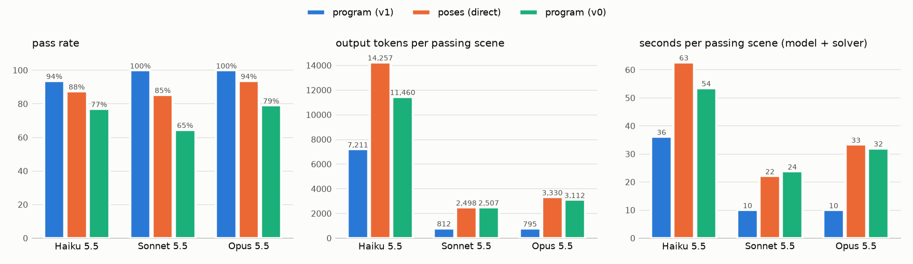</p>

| model | answer | scenes that pass | output tokens / trial | cost / trial | seconds / passing scene |
|---|---|---|---|---|---|
| Haiku 5.5 | program | **45 / 48** | **6,761** | **$0.0041** | **36** |
| | poses | 42 / 48 | 12,474 | $0.0068 | 63 |
| Sonnet 5.5 | program | **48 / 48** | **812** | **$0.019** | **10** |
| | poses | 41 / 48 | 2,134 | $0.029 | 22 |
| Opus 5.5 | program | **48 / 48** | **795** | **$0.036** | **10** |
| | poses | 45 / 48 | 3,122 | $0.078 | 33 |

- **Programs pass where poses need geometry the model cannot see.** Ten drinks came out in the
  wrong order of height in 7 / 9 typed rows (the scene summary gives heights to the centimetre, the
  compiler sorts on the meshes), and packed fruit interpenetrated in 3 / 18 typed packings. Programs
  pass 141 / 144 and poses 128 / 144; every scene of either answer stays at rest in MuJoCo. Where the
  summary says enough, typed poses do as well: they stacked the three cartons centred in all nine
  towers.
- **A program does not grow with the scene.** Sorting a heap of 10, 16 and 24 objects, Haiku's poses
  grow from 6,100 to 24,300 output tokens per trial while its programs stay between 4,600 and 6,700;
  Sonnet's go from 1,300 to 5,000 against 400 to 1,000, Opus's from 2,100 to 6,500 against 880 to
  1,100. Name patterns keep the program's length, and the solver does the per-object work.
- **Cheaper and faster per scene.** Programs take 1.8 to 3.9 times fewer output tokens per trial,
  cost 1.5 to 2.2 times less, and need 1.7 to 3.3 times less time per passing scene, the solver's
  2-3 s per trial included. The system prompt that carries the language is longer (14-18k prompt
  tokens per trial against 3-4k), and it is read from the prompt cache.
- **Where poses do as well.** On the two held-out tasks, of six and seven objects, programs pass
  6 / 6 with every model and poses 6 / 6, 5 / 6 and 6 / 6; poses take less time with Haiku and Sonnet
  (13-15 s per passing scene against 22-25 s) and about as much with Opus (14 s against 12 s): when
  the scene is small and nothing in it needs exact geometry, the model can type the answer, and the
  solver's seconds are the program's price.
- **A program is reusable.** Applied unchanged to five new heaps of its task it is solved again and
  passes 697 of the 705 scenes; with every object replaced by another asset of its category it passes
  140 of 141 scenes, typed poses 79 of 128.
- **The new statements and the request both matter.** Programs restricted to the statements the
  language had before pass 106 / 144; poses repaired by S4R with only the geometric statements every
  task shares (and the supports the answer named) pass 115 / 144, fewer than the poses themselves:
  the repair removes interpenetration but does not know the request (it pushed packed fruit out of
  their square).
- **After a failure, the rewrites help.** Told the rewrites of its failed statements, each of Haiku's
  three failing programs passes. On 92 faulted first answers per model both reports recover nearly
  every fault; with the rewrites no request is weakened (the plain report weakened three), and after
  a margin fault the next round takes 2.3 to 4.4 times fewer output tokens.

<p align="center">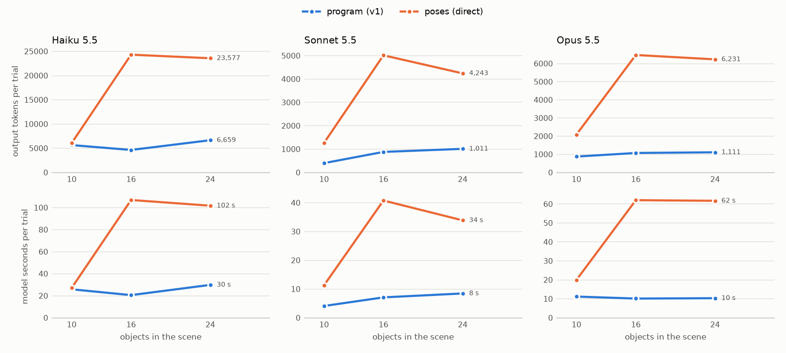</p>

The numbers are those of the run of 2026-10-26 with the current language. The two earlier runs (2026-10-24
and its replay of 2026-10-25) answered an earlier prompt and are published with it
([the runs](docs/EVAL_DSL_vs_direct.md#the-runs)). One rubric check was corrected after the first
model's run of the first run: "within 1 cm of a common line" had been measured from the centres'
mean, which asks for more than the request; every round of the first run it could change was rebuilt
and graded again.

## Getting started

### Setup

```
pip install numpy scipy trimesh rtree fast-simplification python-fcl osqp mujoco coacd usd-core   # Python 3.10+
python -m unittest discover tests                                                                # regression tests
```

`rtree` is what trimesh's ray and point-in-mesh queries run on; without it those queries fail,
and a failed query is reported as an error (exit code 2), never as "no hit". `fast-simplification`
is trimesh's mesh decimator: the continuation runs on 2000-face copies of the bodies and verifies on
the full meshes; without it the repair warns and runs on the full meshes, several times slower and
with gigabytes of collision structures for assets of 50k-130k faces. Optional: `anthropic`
for the SDK backend, which reads `ANTHROPIC_API_KEY` from the environment only (nothing in this
repository holds a credential, and `.env` files are ignored); Blender 4.5 for the renders in
`viz/` (`BLENDER=/path/to/blender`).

### Command line

| command | does | exit 0 means |
|---|---|---|
| `python -m simready.cli summarize <scene>` | body list, sizes, tags, support rectangles | — |
| `python -m simready.cli prompt <scene> --request "..."` | the text-to-program prompt with the schema | — |
| `python -m simready.cli check <scene> program.json` | validate, parse and compile the program | the program is usable |
| `python -m simready.cli verify <scene>` | the mesh-level evaluator on the scene as is | no penetrating pair |
| `python -m simready.cli repair <scene> program.json --out <file>` | S4R under the program, full-mesh verification, write-back, certificate | pen 0, every predicate holds and, with a `G2: min_gap` gate, every pair keeps that clearance |
| `python -m simready.cli settle <scene> --program program.json` | the MuJoCo settle test, thresholds from the program's gate | the scene stays at rest (with a `G2: min_gap` gate, the scene as given is also checked for that clearance) |
| `python -m simready.cli export <scene> --out <dir>` | meshes, manifest, MJCF and USD for MuJoCo, Genesis and Isaac Sim | the files were written |
| `python -m simready.cli assets search\|fetch\|info ...` | find SimReady packages, fetch them checked against their bill of materials, print their physics | the packages were found or fetched |

Exit code 1 means the outcome does not hold; exit code 2 means the program or an input is invalid,
or a geometric query could not be evaluated. A gate value that cannot be parsed, a coordinate that
is not a finite number, a statement with the wrong number of arguments: all of these are exit 2,
none of them is silently dropped.

Scenes are RoboLab `.usda` files (metres, Z up; a stage that says otherwise is refused) or layout
JSONs (`base_scene` + objects); RoboCasa objects come in through `simready.io.mjcf_io` (see
`experiments/robocasa_capacity.py`).

### Running the repaired scene in a simulator

`export` writes a scene the engines load directly: one OBJ per body in its own frame (named by
the body's index, so no two bodies can share a file), a manifest with every pose (metres, Z up),
an MJCF file and a USD stage with UsdPhysics rigid bodies, colliders and a physics scene. A fixed
body whose mesh is a single plane is kept as a 1 cm solid unless it is the ground (a horizontal
sheet at the ground height, or one tagged `ground`), which the export's own ground replaces. The
three runners in `examples/` load that export, step it and print the peak and final displacement
of every free body.

```
python -m simready.cli export pile_repaired.json --out pile_export --program program.json
python examples/run_mujoco.py pile_export --seconds 2                 # MuJoCo, from scene.xml
python examples/run_genesis.py pile_export --seconds 2                # Genesis, from manifest.json (add --cpu without a GPU)
python examples/run_isaac.py pile_export --seconds 2                  # Isaac Sim (its own Python), from scene.usda
```

Each runner takes `--record poses.json` to write the world pose of every free body at 30 frames
per second and `--report report.json` to keep its report; `viz/make_engine_video.py` turns the three
recordings into the side-by-side clip. `examples/install_engines.sh` installs Genesis 1.2.3 and
Isaac Sim 5.1.0 in their own environments, and `viz/run_engines.sh` runs the whole check: the
export, each engine for 2 s, and the clip.

The twenty-object layout certified in September 2026, exported and simulated for 2 s in each engine
on this machine; the three panels below are the recorded trajectories (`--record`), MuJoCo,
Genesis and Isaac Sim from left to right, rendered from the same assets as the other clips:

<table align="center">
<tr>
<td align="center">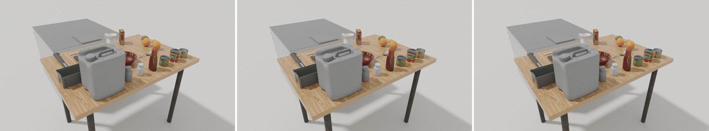</td>
</tr>
<tr>
<td><sub>Left to right: MuJoCo 3.10, Genesis 1.2.3, Isaac Sim 4.5, 2 s of simulation in real time. In every engine the round fruit rolls a little (an orange by 9 cm in MuJoCo, 5 cm in Genesis, 3 cm in Isaac Sim); nothing tips over and no body leaves the table.</sub></td>
</tr>
</table>

Fixtures keep their full meshes, and a fixture with shelves is written as CoACD pieces checked
against the bodies resting on it (`--fixture-grid` for an open mesh). The MJCF file gives every free
body one convex hull unless `--decompose` writes CoACD pieces, Genesis decomposes the meshes itself
(`--convex` for one hull per body), and Isaac Sim's stage asks PhysX for a convex decomposition:

| engine | peak displacement of a free body | bodies below the ground |
|---|---|---|
| MuJoCo 3.10 | 0.089 m (an orange rolling, as in the settle test) | none |
| Genesis 1.2.3, GPU, conjugate-gradient solver | 0.053 m with its decomposition, 0.050 m with one hull per body | none |
| Isaac Sim 4.5 (PhysX) | 0.029 m | none |

A flat fixed sheet such as RoboLab's ground plane has no volume to hull; it is marked `flat` in
the manifest and every runner uses the export's ground height instead. Genesis's Newton
constraint solver needs more shared memory than a 2080-class GPU offers at 120 free degrees of
freedom; the runner therefore defaults to its conjugate-gradient solver (`--solver newton` to
switch).

### Assets

**NVIDIA SimReady packages.** `python -m simready.cli assets search "coffee mug" --max-size 0.2`
asks [SimReady Central](https://huggingface.co/spaces/nvidia/simready-central) (text and SigLIP2
image search over the SimReady datasets) and lists packages with their size, mass and license;
`assets fetch <package> ...` downloads them from
[nvidia/simready-assets](https://huggingface.co/datasets/nvidia/simready-assets) without their
textures, checks every file against the package's bill of materials and records the dataset
commit; `assets info <package>` prints what the gate reads. A layout names packages directly:

```json
{"table": {"package": "table_metal_stainless_a03", "position": [0.548, 0.0, -0.055], "yaw": 90},
 "objects": [{"name": "mug", "package": "dishware_mug_coffee_a01", "x": 0.517, "y": 0.110, "z": 0.0, "yaw": 30}]}
```

From a package the loader reads the mesh, the mass, the centre of mass and the inertia
(UsdPhysics `MassAPI`), friction, restitution and density (the bound `PhysicsMaterialAPI`), the
semantic class (`semantics:labels`, e.g. `coffee mug`) and the grasp hint SimReady props carry (the
mug's handle is on its local -x side, which the scene summary prints for `facing`). An asset
authored in a pose it cannot rest in (a cutting board on its edge) is re-expressed in its most
stable resting frame, by the rule `simready/data/asset_rest_orientations.json` applies to RoboLab's
catalog. The settle test and the export give every such body its own friction and mass (and
restitution in USD) instead of the defaults, and `balanced_on` uses its centre of mass. Fetched
files live under `SIMREADY_ASSETS_DIR` and are written as `<SIMREADY_ASSETS_DIR>/...` in layouts,
certificates and manifests; a repair never downloads.

A layout can also:

- add fixtures: `"fixtures": [{"name": "case", "package": "cabinet_file_d02", "position": [0.65, 0, 0], "yaw": 180}]`;
- stand an object on another side: `"up": "+y"` (a book on its edge);
- name the side that faces out: `"front": "-x"` (its spine), for `axis=front`.

`--repo` fetches from the other datasets SimReady Central indexes. The shelf examples also use
`PalatialSim/palatial-nv-asset-library` (CC BY 4.0, credit: PalatialSim).

**Scenario 3D Collection.** `simready/data/scenario_assets.json` lists 37 tabletop objects chosen
from [scenario-labs/3d-collection](https://huggingface.co/datasets/scenario-labs/3d-collection),
1,342 AI-generated assets under CC BY 4.0 (credit: Scenario), pinned to commit `55b4c002`. For each
it gives the GLB and its sha256, the class, one real dimension, the mass, the material's friction and
restitution, the side of the handle and whether other objects can be put inside. The meshes carry no
physics and no real size, so these values are estimates for each kind of object, not measurements.
`python -m simready.cli assets list scenario` lists them. `assets fetch scenario:<name>` downloads an
asset, checks its sha256, turns glTF's +y up to +z, scales it to its dimension, puts its origin at the
centre of its footprint on its lowest point and decimates a mesh above 40,000 faces; the record keeps
how far the decimated surface lies from the original (at most 4.9 mm, on the radio; 2 mm or less on
the others). `assets info scenario:<name>` prints what the gate reads. A layout names an asset with
`scenario`:

```json
{"name": "mug", "scenario": "mug_white", "x": 0.45, "y": 0.10, "z": 0.0, "yaw": 0}
```

The list keeps single rigid objects a robot meets on a table. It leaves out the collection's
characters and scenes, generated objects that come in many loose pieces (an hourglass, a typewriter),
those with a separate part beside them (a bottle and its cap), and its Gaussian splats, which have no
mesh.

RoboLab and RoboCasa assets are not redistributed here. The experiments and the video drivers read
them from their own checkouts: set `ROBOLAB_DIR` to a checkout of
[NVLabs/RoboLab](https://github.com/NVLabs/RoboLab) (with its LFS assets pulled) and
`ROBOCASA_AIGEN_DIR` to RoboCasa's `aigen_objs` folder.

An asset's authored frame is not always the pose it rests in. RoboLab's remote control is authored
standing on its 3.6 × 2.5 cm end, 16 cm tall, a pose that tips at 8.7°; every shipped scene that
contains it has it lying on its back. `simready/data/asset_rest_orientations.json` lists the
catalog assets whose authored pose cannot stand (tipping angle below 12°, mass centre at the box
centre) together with the authored axis that points up in the shipped scenes, and the loaders
re-express those assets in that resting frame: the vertices turn once, the pose rotation absorbs
the inverse, the world geometry is unchanged. A layout that sets only a yaw then lays the remote
flat, `upright` keeps it flat, the placement solver sees its resting footprint, and the export
writes it lying. `experiments/asset_rest_orientations.py` regenerates the table from the catalog
and the shipped scenes; assets that can stand keep their authored frame, because the shipped
scenes are physics-settled heaps in which cans and cartons also lie knocked over.

## Gates

| gate | question | tool |
|---|---|---|
| G0 | is the asset admissible: collision and visual geom counts, a watertight merged collision mesh, collision extents against `reg_bbox` | `mjcf_object_stats` |
| G2 | does any pair interpenetrate, is any body inside another, is any body unsupported, and (with `min_gap`) does every pair other than a body and its declared support keep the clearance? | FCL score with probed normals, containment and resting-contact tests (`simready.gates.verify`); pair-by-pair clearance with coverage (`simready.gates.clearance`) |
| G3 | the repair: S4R scale continuation under the program | `simready.repair.upright_s4r` |
| G5 | does the scene stay at rest in a physics engine? | MuJoCo settle with hull and CoACD proxies (`python -m simready.cli settle`) |

## Results

Measured on RoboLab's 68 shipped scenes, on pre-settle layouts from RoboLab's own placement
solver staged in its base scene, and on RoboCasa counter regions with RoboCasa's own placement
test; every table is backed by a tracked file under `results/`.

- **RoboLab library**: object-object mesh penetration in 26 / 68 scenes (12 at or above 1 mm; all
  of them surface intersections, none a body wholly inside another), a body nothing supports in 30.
- **RoboLab pre-settle layouts** (N = 4–10, 3 seeds): the disc solver accepts 5 / 12 and those are
  clean; the 7 it rejects carry 1–7 penetrating pairs, and S4R repairs all 7 to zero with every
  requested relation and region kept (planar RMSD 0.03–0.16 m, 3–15 s per cell).
- **Settle** (MuJoCo, identical harness): median peak speed 0.5 → 0.3 m/s (hull proxies) and
  0.4 → 0.2 m/s (CoACD) from the seated raw layouts to the repaired ones; every repaired cell
  passes and nothing leaves the table.
- **RoboCasa** (own placement test, 5 seeds): the box test is conservative and reliable; it gives
  up in a 0.3 m square at 8–12 objects (4/5, 1/5, 0/5), where the gate places every object (5/5).

Full tables and the fixes behind them:
[`docs/DIAGNOSTIC_2026-09-08.md`](docs/DIAGNOSTIC_2026-09-08.md). Design note: [`docs/design.html`](docs/design.html).

## Repository layout

```
simready/            the library
  scene/             Body, Scene, mesh proxies, surface-based seating
  gates/             verify.py (G2)  clearance.py (G2 min_gap)  settle_mujoco.py (G5)
  repair/            upright_s4r.py: S4R upright-on-plane continuation with program rows
  dsl/               model.py (parser)  schema.py (JSON schema, prompt)  compile.py  statements.py (the v1 statements' rows and predicates)  text2dsl.py  anthropic_backend.py
  io/                usd_io.py (RoboLab USD read/write)  mjcf_io.py (RoboCasa MJCF via MuJoCo)  export.py (meshes, manifest, MJCF, USD for the engines)
                     nvidia_assets.py (SimReady packages: search, fetch, physics and semantics)
                     scenario_assets.py (Scenario 3D Collection: fetch, normalize, bodies with the curated physics)
  data/              asset_rest_orientations.json, scenario_assets.json (the curated Scenario assets)
  errors.py          GeometryQueryError: a query that could not be evaluated is an error, not a result
  cli.py             summarize | prompt | check | verify | repair | settle | export
examples/            run_mujoco.py, run_genesis.py, run_isaac.py: load an export and simulate it
tests/               regression tests (python -m unittest discover tests)
skills/              the agent skill that runs the loop
experiments/         the diagnostics behind docs/DIAGNOSTIC_2026-09-08.md (RoboLab, RoboCasa, settle)
  shelf_layouts.py   the layouts of the shelf examples (docs/examples/shelf_*)
  dsl_vs_direct/     the program-or-poses comparison: SimReady tasks and rubrics, the isolated CLI calls, the leak test, the regrade, settle and reuse, the tables and figures
viz/                 Blender rendering on the solver's meshes, video drivers, the agent-run page generator
results/             tracked result tables and the persisted layouts
docs/                diagnostic notes, design note, the language (DSL.md), the comparison (EVAL_DSL_vs_direct.md), media, the recorded example runs
```

## Citation

SimReady Gate builds on S4R; please cite both.

```bibtex
@article{dou2026s4r,
  title   = {S4R: Scaling for Rigid-Body Interpenetration Resolution},
  author  = {Dou, Zhiyang and Zhao, Ang and Peng, Chen and Guo, Minghao and
             Wu, Haixu and Lin, Cheng and Liu, Yuan and Yao, Junfeng and
             Guo, Xiaohu and Wang, Wenping and Matusik, Wojciech},
  journal = {ACM Transactions on Graphics (SIGGRAPH Asia)},
  year    = {2026},
}

@misc{dou2026simreadygate,
  title        = {SimReady Gate: Language-Driven, Verifier-in-the-Loop Repair of Generated Scenes},
  author       = {Dou, Zhiyang and Matusik, Wojciech},
  year         = {2026},
  howpublished = {\url{https://github.com/Frank-ZY-Dou/Dynamics-Modeling/tree/main/SimReady_Gate}},
  note         = {Part of Dynamics-Modeling},
}
```

## License

MIT. RoboLab and RoboCasa assets are not redistributed here; the experiments read them from
their own checkouts (`ROBOLAB_DIR`, `ROBOCASA_AIGEN_DIR`).
